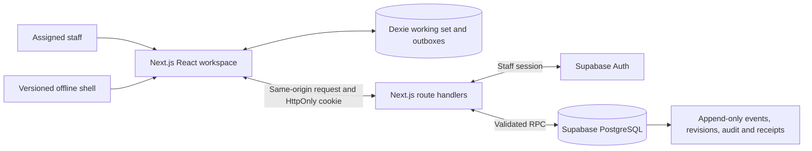

# Maatri-Shishu development plan

Updated 4 November 2026. This is the implementation plan and delivery status for the user's chosen stack. [The PRD](Maatri-Shishu_Research_Report_and_PRD.md) remains the source of requirements and clinical boundaries; its original technology recommendation is superseded by the stack below.

## Delivery scope

The current deliverable is a runnable synthetic engineering demonstration with a documented path to Supabase. It includes the core registration, care evidence, follow-up, calendar, review and offline workflows. Coding completion does not establish clinical approval or authorize a live pilot.

Phase 2 SMS, growth measurements and approved HMIS CSV mapping remain separate work. Diagnosis, treatment advice, automatic catch-up/Td recommendations, risk scores and replacement of official records are excluded.

## Implemented architecture

| Layer | Choice | Responsibilities |
|---|---|---|
| Application | Next.js 16 App Router, React, strict TypeScript | Protected page entry, workspace shell and same-origin route handlers |
| Presentation | Tailwind CSS v4, local shadcn/ui components, Radix Dialog | Responsive forms, keyboard dialogs, status labels and accessible controls |
| Validation | Zod schemas plus PostgreSQL RPC validation | Date/source fields, role restrictions and relationship integrity on both sides |
| Local storage | Dexie / IndexedDB | Assigned working set, transactionally saved forms, outbox, access audit and offline lease |
| Server data | Supabase PostgreSQL | Domain tables, foreign keys, RLS, immutable events, revisions and idempotency receipts |
| Authentication | Supabase Auth through Next.js server code | Individual accounts, HttpOnly cookies, cookie refresh and active staff checks |
| Sync | `/api/workspace`, `/api/sync`, `/api/audit` | Full scoped snapshots, dependency-ordered atomic form batches and explicit conflicts |
| Offline shell | Manifest and versioned service worker | Static HTML/JS/CSS/icon cache; protected API responses are never put in Cache Storage |
| Languages | `en`, `ne`, `bho` catalogs and bundled fonts | UTF-8 support and persisted preference; wording/coverage still requires review |
| Verification | Vitest, Playwright/axe, PGlite PostgreSQL | Domain/storage behavior, browser workflows, SQL/RLS/RPC checks |
| Delivery | npm scripts and GitHub Actions configuration | Reproducible install/build, checks, schema-derived OpenAPI and artifacts |

There is no separate FastAPI service, Python runtime, Vite application or application-managed password database. PostgreSQL is authoritative after acknowledgement. The local demo runs the TypeScript rules against fictional data without contacting Supabase.

## Data and API contract

`src/lib/domain/types.ts` and [OpenAPI](docs/openapi.json) define mothers, pregnancies, births, children, care events, event reviews, appointments, follow-ups, attempts, sessions, consent history, schedules and identity reviews. Each record has a UUID, facility, ward, revision, timestamps and creating actor.

The database stores validated JSONB payloads in separate domain tables with generated foreign keys. Polymorphic subjects have explicit mother/child constraints. Protected tables deny direct application writes; command RPCs validate staff role, active status, scope, linked records and expected version before changing data. Administrative setup uses separate private credentials.

Dates are Gregorian `YYYY-MM-DD`; clinical dates use calendar-day/month arithmetic. Event/audit timestamps are ISO 8601, with Nepal time used for daily boundaries. Bikram Sambat entry/conversion is not implemented.

The implemented API is a workspace command API documented in [docs/API.md](docs/API.md), rather than the PRD's illustrative per-resource REST paths. Every record kind is represented in the typed command contract. Large-scale incremental pagination/cursor sync is still pending.

## Offline and conflict behavior

1. A form's related records, pending operations and local audit metadata commit in one Dexie transaction. A failed validation leaves none of that form saved.
2. Local IDs remain stable. Parent creates and earlier revisions are ordered before dependent writes, including operations with equal device timestamps.
3. Connected sync checks the current account and assignment, then sends each form as one PostgreSQL transaction. Repeated operation IDs return the committed receipt; reuse with a different payload conflicts.
4. Entries leave the outbox only after acknowledgement. Connection/server failures retry with exponential delay, capped at 60 seconds while the app is open. Browser background execution is not assumed.
5. Stale edits are visible in the review queue. A single editable change can be reapplied after review. A multi-record conflict must be reviewed/discarded as a group and re-entered against shared records; there is no automatic merge.
6. Connected offline access has a four-hour engineering lease, checked on writes and periodically/focus while open. Reauthentication/refresh requires connectivity. Immediate remote revocation of a disconnected browser is not possible.
7. Profile reads and prints queue UUID/timestamp/action metadata, bounded at 1,000 unsent access events. No patient narratives enter that queue. Sign-out first tries sync and preserves unresolved work rather than silently deleting it.

IndexedDB is not automatically encrypted. The four-hour lease, queue bound, working-set size and lost-device handling are engineering defaults awaiting controller/device-policy approval.

## Authority matrix

| Role | Clinical records | Care verification | Appointments / sessions | Schedule authority |
|---|---|---|---|---|
| FCHV | Assigned registration, summaries and contact outcomes; unverified vaccination history | None | Read | Active versions only |
| Health worker | Assigned records; clinical events and reasoned corrections | Yes | Create/update | Active versions only |
| Supervisor | Assigned records and identity-review resolution | Yes | Create/update | Active versions only |
| Clinical approver | No clinical browsing | None | None | Draft and clinical approval |
| Municipality administrator | No clinical browsing | None | None | Separate programme activation |
| System administrator | No clinical browsing | None | None | Draft administration; private staff provisioning outside normal UI |

Connected users cannot switch roles in the browser. Demo role switching is a training feature only. Staff assignment remains an administrative script/dashboard procedure; an in-app staff management console is not implemented.

## Requirement coverage

“Implemented” below refers to engineering behavior, not external sign-off. Detailed acceptance evidence is in [the checklist](DEVELOPMENT_CHECKLIST.md).

| PRD requirement | Implementation / remaining acceptance |
|---|---|
| FR-001–002 Auth and scope | Supabase SSR Auth, staff/scopes, RLS, domain/RPC checks; hosted cookie/login/rate-limit testing pending |
| FR-003 Mother registration | Consent, optional phone, search and explicit duplicate-review records; merge/transfer decision application pending |
| FR-004 Pregnancy | Multiple sourced episodes, unknown dates and review flag; richer historical episode selection remains a backlog item |
| FR-005 ANC | Source/provider/date, verified count and provider-entered appointments; approved gestational/late-first-contact configuration pending |
| FR-006 Birth/child | Independent child, uncertain DOB, birth source/place/time, pregnancy linkage, twins and audited correction reason |
| FR-007–010 Schedule/vaccines | Version selection, dual approval, calendar arithmetic, verified/unverified/review states and due-only denominator; clinical sign-off and approved overdue/grace rule pending |
| FR-011 PNC | Separate mother/newborn records with provider-entered timing; no shared completion inference |
| FR-012–013 Follow-up | Worklists, people/status/date buckets, structured outcomes, explicit verified-care closure; advanced reassignment and arbitrary date-range filtering pending |
| FR-014 Calendar | Create/edit/cancel local sessions; dates separate from theoretical vaccine due dates; pending publication state |
| FR-015 Languages | Three catalogs and persisted preference; full string externalization, approved glossary and human review incomplete |
| FR-016 Offline | Durable local writes, atomic upload batches, receipts, visible conflicts, offline shell and lease; full snapshot pull currently |
| FR-017 Consent | Creation gate, append-only changes, suppression of optional app follow-ups and handling review after withdrawal; authority's retention/disposal process still to be agreed |
| FR-018 Audit | Mutation/verification/schedule audit, server revisions, access queue, export audit; full administrative/denied-access auditing and production monitoring still require review |
| FR-019 Print/export | Permissioned summary with disclaimer and JSON export; approved HMIS CSV mapping deferred |
| FR-020 Recovery | Runbook supplied; encrypted hosted backup and clean restore exercise not yet demonstrated |
| FR-021–022 | SMS and raw growth records deferred to Phase 2 |
| FR-023 Td | Pregnancy-linked maternal Td event/source/verification; no automated dosing advice |

## Remaining milestone plan

| Milestone | Current state | Next deliverable / responsible role |
|---|---|---|
| M0 — Scope and policy | Synthetic scope and stack decided; external decisions open | Name product, clinical, controller, language and operations owners |
| M1 — Foundation | App, schemas, Auth integration, persistence and SQL checks implemented | Hosted Supabase two-account smoke test and deployed cookie/origin review; engineering + operations |
| M2 — Care workflows | Core records/events/reviews implemented | Agreed transfer/merge workflow, historical episode UX and field dictionary review; product + clinical + engineering |
| M3 — Schedule | Engine and approval workflow implemented with test fixtures | Signed source/version, independent schedule QA and approved overdue/ANC/PNC configuration; clinical + programme owner |
| M4 — Operations | Follow-ups, appointments, calendar and basic reports implemented | Staff reassignment, cohort/withdrawal policy, report/date-filter acceptance; product + health-post reviewer |
| M5 — Hardening | Automated browser/accessibility/offline checks available | Finish translations, test actual low-end Android, measure volumes/latency and field usability; language + UX + QA |
| M6 — Release evidence | Demo instructions, API, CI and runbooks supplied | Hosted backup restore, incident exercise, support/training and release sign-offs; operations + controller |

The initial 13–20-week estimate described a staffed delivery and external-validation programme, not the remaining coding time. Re-estimate after owners, target volume and field feedback are known.

Open decisions D-01–D-08 remain: pilot catchment and official systems; signed clinical schedule/configuration; fields/identity/transfer policy; controller/consent/retention; device/offline access; language glossary; reference device/volume; hosting/support/backups. No live-data approval is inferred from this repository or its test results.
