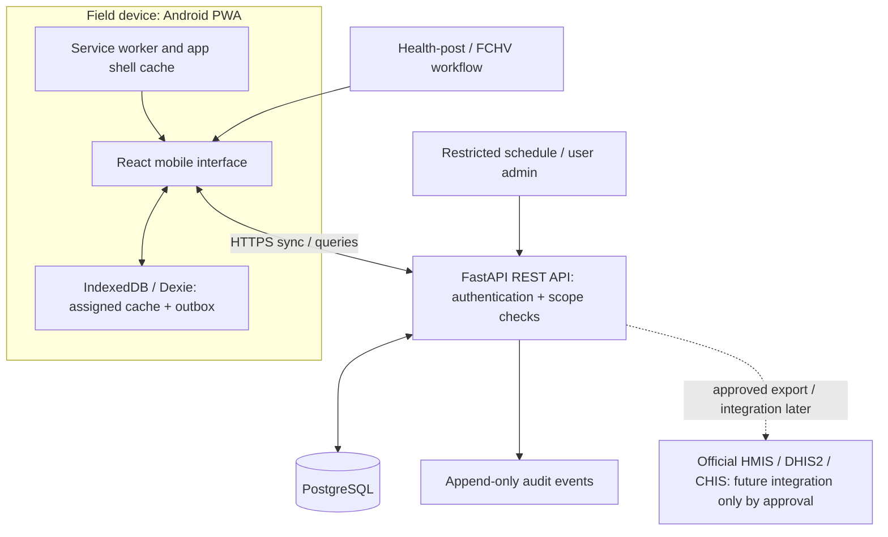

# Maatri-Shishu (Mother–Child Health Tracker)
## Evidence-based research report and implementation-ready product requirements document

**Target geography:** Rural municipalities of Parsa District, Madhesh Province, Nepal  
**Document date:** 3 November 2026  
**Status:** Research-informed product specification for stakeholder validation and a controlled demonstration; **not** an authorization to deploy a clinical system  
**Primary operating model:** Female Community Health Volunteer (FCHV)- and health-post-assisted, mobile-first, offline-capable workflow

> **Clinical safety notice:** This product is a care-continuity and record-management aid. It must not diagnose, prescribe, triage emergencies, decide eligibility for vaccination, or replace a health professional, the national immunization register, HMIS/DHIS2, ANC/PNC clinical records, or the mother-and-child health card. Vaccine schedules and maternal-care protocols must be signed off by the competent Government of Nepal health authority before production use.

---

# Part I — Stage 1: Research report

## 1. Executive summary

### 1.1 What the evidence supports

There is a defensible public-health use case for helping families and frontline workers maintain continuity across pregnancy, birth, postnatal care and childhood immunization. Nepal has an established national immunization programme, an eight-contact antenatal-care (ANC) recommendation, postnatal-care (PNC) follow-up guidance, FCHVs, fixed/outreach vaccination sessions and national health-information infrastructure. Those systems create a need for dependable local follow-up, but also mean that a new application must fit into existing workflows rather than create a parallel health system.

The most recent household-survey evidence available for this research is the **Nepal Multiple Indicator Cluster Survey (MICS) 2024–25**, conducted by the National Statistics Office with UNICEF and published in February 2026. It reports that 70.4% of women in Madhesh had at least four ANC contacts and 23.2% had at least eight. These are household-survey estimates, not facility administrative indicators. The Department of Health Services (DoHS) Annual Health Report FY 2081/82 separately reports 89.96% for four ANC contacts and 60.07% for eight contacts in Madhesh using administrative reporting. These figures must not be treated as directly comparable because their data sources, denominators and measurement processes differ. [R1, R2]

The current routine childhood schedule reproduced in MICS 2024–25 includes vaccination contacts at birth, 6, 10 and 14 weeks, and 9, 12 and 15 months. It includes fIPV at 14 weeks and 9 months, and typhoid conjugate vaccine at 15 months. Historical schedules differ. Therefore, the application must store schedule versions, effective dates, dose rules and approving authorities; it must not embed a permanent vaccine timeline in source code. [R1, R3]

### 1.2 What the evidence does not establish

This research did not locate a recent public dataset that reliably measures missed routine childhood doses, ANC/PNC drop-off, card-loss frequency, smartphone access among mothers, or internet access at the **rural-municipality or health-post catchment level in Parsa District**. Provincial and national statistics cannot be presented as Parsa-specific. A qualitative NHRC/UNICEF study contains an interview site called “Parsa Rural Municipality,” but that site is in **Sarlahi District**, not Parsa District. Its report of a lost immunization card is useful as a Madhesh-region example only; it is not local evidence for the target district. [R4]

Consequently, the product should begin as a **controlled, co-designed pilot** with local health posts and FCHVs. The first release should test whether the proposed worklist actually reduces follow-up effort and improves record continuity, not claim a proven reduction in mortality or vaccine dropout.

### 1.3 Product recommendation

Build a **small, offline-capable FCHV and health-post follow-up workspace** that:

1. Keeps pregnancy and child records linked while allowing a child to be registered independently when needed.
2. Generates a child’s due-date timeline from a health-authority-approved, versioned national schedule.
3. Records care events with provenance: provider-administered, transcribed from a card, or reported by a caregiver.
4. Shows assigned upcoming and overdue work to the responsible FCHV or health-post worker.
5. Records follow-up attempts and outcomes without implying that every overdue dose was refused or missed.
6. Works on low-end Android phones with unreliable connectivity and synchronizes safely when connectivity returns.
7. Supports human-validated Nepali and Bhojpuri text, with English for administration and development.

**Positioning statement:** *An offline-first, Bhojpuri/Nepali-enabled follow-up workspace for FCHVs and health posts that connects pregnancy care, newborn registration and child immunization timelines, highlights who needs follow-up, and preserves provider-verified events—without replacing the official register, HMIS or paper health card.*

### 1.4 MVP boundary

For the first demonstration, include assisted registration, pregnancy and birth records, ANC/PNC milestone tracking, a validated routine child-immunization schedule, vaccination recording, due/overdue lists, follow-up outcomes, role-based access, offline queueing, language selection, printing/export and audit history. Defer SMS gateways, mother self-service accounts, clinical decision support, growth-chart interpretation, government API integration and any AI feature.

---

## 2. Evidence labels and research method

This report uses the following labels throughout:

- **Verified fact:** Directly stated in an official policy, survey, government report or primary source cited below.
- **Research-backed observation:** Supported by a published study or system documentation, but not necessarily measured in Parsa District.
- **Assumption:** A product-planning hypothesis that must be tested.
- **Recommendation:** A design decision based on the evidence and constraints.
- **Local validation required:** A question that must be answered with Parsa Health Office, municipal health sections, health-post staff, FCHVs and mothers before a live pilot.

The research prioritized Nepal Government, DoHS, Family Welfare Division (FWD), National Statistics Office, UNICEF, WHO and NHRC sources. Where a source is an older annual report or a programme page describing an initiative, it is identified as such rather than treated as evidence of current deployment.

---

## 3. Nepal’s maternal and child healthcare landscape

### 3.1 National immunization programme

**Verified facts.** Nepal operates a national routine immunization programme through fixed and outreach services. DoHS reporting describes sessions at health facilities and outreach locations, with local authorities deciding the number, location and dates of outreach clinics according to local needs. These sessions are supported by health-post staff and FCHVs. Session dates can therefore be locally configured and may change; the app must not assume that a child's theoretical due date is identical to the next available clinic date. [R2, R5]

The MICS 2024–25 report includes the following routine schedule for the 2024–25 reference period. This is the best accessible current schedule cross-reference found in this research; before production use, the exact schedule, dose labels, catch-up rules and any changes after the survey period must be confirmed against the latest signed Child Health and Immunization Service Section (CHISS) schedule and the current HMIS guideline. [R1, R3, R6]

| Age | Vaccines listed in the MICS 2024–25 schedule | Product interpretation for a timeline | Implementation note |
|---|---|---|---|
| At birth | BCG | BCG dose 1 | Record date administered; a late administration remains a recorded event. |
| 6 weeks | Rota, Polio, PCV, DPT-HepB-Hib | Rotavirus 1, polio 1, PCV 1, pentavalent 1 | Confirm exact product/dose labels with CHISS. |
| 10 weeks | Rota, Polio, PCV, DPT-HepB-Hib | Rotavirus 2, polio 2, PCV 2, pentavalent 2 | Confirm product availability and local register conventions. |
| 14 weeks | Polio, fIPV, DPT-HepB-Hib | Polio 3, fIPV 1, pentavalent 3 | Do not confuse oral polio vaccine (OPV) and fractional IPV. |
| 9 months | fIPV, PCV, MR | fIPV 2, PCV 3, MR 1 | Historical schedules differ; effective date is critical. |
| 12 months | JE | Japanese encephalitis 1 | Confirm campaign/outreach delivery arrangements locally. |
| 15 months | MR, Typhoid | MR 2, typhoid conjugate vaccine 1 | Confirm current official naming and age window. |

**Important schedule caveat.** Older Nepal documents show fIPV at 6 and 14 weeks, and older vaccine schedules pre-date typhoid vaccine at 15 months. FWD documentation indicates a shift in fIPV timing from November 2022. This demonstrates why a record created under an older schedule must retain its original schedule version. Never retroactively alter a historical administration record when the schedule is updated. [R3, R6]

**Recommendation.** Store the schedule as data, not code. Each schedule version must include: unique version ID, publication/reference, issuing authority, approval date, effective-from date, optional effective-to date, dose identifier, vaccine/product name, recommended age, date-calculation rule, permissible administration window only where explicitly approved, and supersession link. Production activation must require dual approval by an authorized health-program administrator and a clinical schedule approver.

### 3.2 Maternal ANC protocol

**Verified facts.** FWD’s *ANC to PNC Continuum of Care Guideline* (2023; document printed 2079/80) supports at least eight ANC health contacts and early initiation, with the first contact during the first trimester/by 12 weeks. The guideline describes an integrated continuum from pregnancy through postnatal care. [R7]

The MICS 2024–25 report uses the recommended eight-contact model and first-trimester initiation as the reference for its ANC indicators. [R1] The WHO eight-contact model commonly places contacts at up to 12, 20, 26, 30, 34, 36, 38 and 40 weeks of gestation. This is a reference model, not permission for the software to impose dates where national/local clinical guidance or the provider’s care plan differs. [R19]

**ANC cadence reference (requires FWD/health-post sign-off before activation):**

| Contact | Reference gestational age | Product handling |
|---|---:|---|
| 1 | Up to 12 weeks | Highlight first-trimester initiation only when LMP/gestational age is reliable. |
| 2 | 20 weeks | Provider-confirmed appointment. |
| 3 | 26 weeks | Provider-confirmed appointment. |
| 4 | 30 weeks | Provider-confirmed appointment. |
| 5 | 34 weeks | Provider-confirmed appointment. |
| 6 | 36 weeks | Provider-confirmed appointment. |
| 7 | 38 weeks | Provider-confirmed appointment. |
| 8 | 40 weeks | Provider-confirmed appointment; care beyond this point remains professional-led. |

**Important product boundary.** A digital calendar should not invent a full schedule of appointment dates from memory or distribute outdated tables. The national guideline contains protocol tables and clinical content that need review by FWD/municipal health authorities. The MVP can safely:

- record the first ANC contact and the date of subsequent contacts;
- display the count of completed contacts against the eight-contact target;
- show an appointment date entered or confirmed by a health worker;
- indicate when the first recorded contact occurred after the first trimester;
- remind the user that the health post determines the clinical follow-up plan.

It should **not** independently determine tests, diagnose high-risk pregnancy, calculate treatment, or prescribe a date where a professional has not set one. For a demonstration, planned ANC dates may be seeded from an approved local checklist, clearly labelled as sample data.

### 3.3 PNC protocol

FWD’s 2023 ANC-to-PNC guideline lists follow-up points at approximately 24 hours, day 3, days 7–14 and 6 weeks after birth for mother and newborn. The exact care content belongs to the guideline and trained provider, not an automated recommendation engine. [R7]

MICS 2024–25 reports that 90.5% of mothers and 91.6% of newborns received a health check within two days, nationally. The survey distinguishes a health check following birth from a separate postnatal visit; its indicator can include a check during a facility stay. It also reports that 71.6% of newborns received at least two selected PNC signal functions within two days. These definitions matter: a high “health check” percentage does not imply that every subsequent PNC contact was completed. [R1]

**Recommendation.** Create separate mother and newborn PNC events, each with timing, provider/facility, source and completion status. Do not collapse mother and newborn PNC into one binary “postnatal done” field.

### 3.4 Maternal Td vaccination and maternal/newborn programmes

**Verified facts.** DoHS Annual Health Report FY 2081/82 reports a maternal immunization indicator for pregnant women who completed Td2 or Td2+; the reported Madhesh coverage is 85% in the relevant administrative figure. Nepal’s NITAG country report describes two tetanus-containing vaccine doses in a first pregnancy and a further dose in subsequent pregnancies, while national maternal/newborn standards describe a multi-dose protection history and intervals. The exact dose needed in a current pregnancy therefore depends on previous documented doses and timing; it is unsafe to assume “two doses for every pregnancy.” [R2, R20, R21]

**Product requirement:** record maternal Td/Td-containing vaccine administrations as provider-entered events with dose, date, source and verifier. Do not build an automated maternal Td catch-up engine until FWD/CHISS supplies a signed current decision table for prior immunization history. If no verified prior history exists, show “review with health worker,” not a system-generated dose recommendation.

DoHS Annual Health Report FY 2081/82 also lists the **Aama Surakshya Programme and Free Newborn Programme**, as well as maternal/perinatal death surveillance and response. These programmes are part of the government maternal/newborn service context, but eligibility, incentives, benefits and referral rules should not be calculated by the app unless the local health authority provides current approved rules. [R2]

**Recommendation:** include a locally approved static “where to get help / programme information” page in a later phase; do not represent the app as an entitlement checker, payment calculator or referral authority.

### 3.5 Government programmes and frontline service delivery

Relevant programme context includes the National Immunization Programme, Safe Motherhood and Newborn Health services, ANC/PNC guidelines, FCHV programme, health-post and outreach services, HMIS/DHIS2 reporting and local-government health planning. The system should fit into this continuum and not assume that FCHVs independently administer vaccines or make clinical decisions.

DoHS reports that FCHVs support maternal/newborn follow-up and community health activities. Its annual report also describes community health programme pilots in Bardibas Municipality (Madhesh) and other localities. Bardibas is evidence that community-health digital models have been piloted in Madhesh, not proof that the same tools are deployed in Parsa District or that local FCHVs already use them. [R2, R5]

### 3.6 How records and reports are currently organized

**Verified system facts.** The DoHS Integrated Health Information Management Section publishes HMIS guidelines, an Annual Health Report and related information resources. Nepal has used DHIS2 as an important reporting platform; programme dashboards and programme-specific trackers exist. A Nepal immunization dashboard is accessible behind a login, so the existence of a portal does not reveal its full functionality or give this project API access. [R8, R9]

Health facilities and FCHVs also use paper registers, cards and routine reporting processes. The current 2082 HMIS guideline is listed by DoHS; the project team must obtain and inspect the relevant forms and reporting rules before designing data entry or exports. It must not assume every health post has an identical fully digital longitudinal record. [R8]

**Local validation required.** For each pilot health post, observe the actual workflow and collect de-identified copies or field lists for:

- ANC register / antenatal card;
- delivery and birth register;
- mother and newborn PNC register;
- home-based child health/immunization card;
- vaccination register and tally sheet;
- PHC/ORC clinic calendar and session register;
- FCHV household/pictorial register and monthly reporting mechanism;
- municipality/health-office reporting and review process.

The product should map to these fields rather than impose a new clinical form. Where it cannot integrate with the formal register, provide a simple export and make the duplicate-entry burden visible during the pilot.

---

## 4. Evidence of the problem: national, Madhesh and Parsa

### 4.1 Maternal-care indicators

| Source and period | Geography | Indicator | Result | Interpretation |
|---|---|---|---:|---|
| Nepal MICS 2024–25, household survey | Madhesh | Women with 4+ ANC contacts | 70.4% | Survey estimate; not a facility administrative rate. |
| Nepal MICS 2024–25, household survey | Madhesh | Women with 8+ ANC contacts | 23.2% | Indicates a gap between four and eight contacts in the survey cohort. |
| DoHS Annual Health Report FY 2081/82, facility administrative reporting | Madhesh | 4 ANC visits indicator | 89.96% | Administrative reporting indicator; not directly comparable to MICS. |
| DoHS Annual Health Report FY 2081/82, facility administrative reporting | Madhesh | 8 ANC visits indicator | 60.07% | Administrative reporting indicator; not directly comparable to MICS. |
| Nepal MICS 2024–25, household survey | Nepal | Mother with health check within 2 days | 90.5% | MICS definition can include check during facility stay. |
| Nepal MICS 2024–25, household survey | Nepal | Newborn with health check within 2 days | 91.6% | Not a measure of all four later PNC time points. |

Sources: [MICS 2024–25](R1), [DoHS Annual Health Report FY 2081/82](R2).

**What this says:** care-contact continuity remains a legitimate product problem to test, particularly completion of the full eight-contact ANC recommendation. It does not establish that an app will solve the gap or that the reasons are specifically card loss or appointment confusion.

### 4.2 Child immunization indicators

- NDHS 2022 reported that 42% of children aged 12–23 months in Madhesh were fully immunized according to the full national schedule at that time, compared with 52% nationally. Basic-antigen coverage was 68% in Madhesh versus 80% nationally. These are 2022 data under the schedule then in force; they should be used as historical baseline context, not current coverage. [R10]
- MICS 2024–25 reports national coverage of 89.4% for its defined “basic antigens” indicator among children aged 12–23 months. Its “all antigens” coverage measure for children aged 24–35 months is 75.4%. These indicators have different age groups and definitions; do not combine them into one trend line or directly compare them with NDHS 2022 without a harmonized definition. [R1]
- DoHS Annual Health Report FY 2081/82 administrative vaccine coverage includes some values above 100% for Madhesh. Coverage above 100% can arise when administrative numerator and target-population denominators do not align; it is not proof every child in the target cohort received all doses. Cohort-level follow-up requires individual records and careful denominators. [R2]

**Product implication:** Track each child’s dose events, source and verification; calculate due/overdue status at individual level; report denominators transparently. Do not rely on a single regional “coverage percent” to identify a child who needs follow-up.

### 4.3 What is known specifically about Parsa District

**Evidence gap.** No recent publicly accessible district/palika-level dataset was located in this research that provides a reliable current estimate of routine immunization dropout, child dose timeliness, ANC eight-contact completion, PNC four-contact completion, lost-card frequency, maternal smartphone ownership or FCHV digital literacy across rural Parsa District.

A qualitative NHRC/UNICEF study on health-seeking behaviour includes a field site named Parsa Rural Municipality. Its site table and annex identify it as **Parsa Rural Municipality, Sarlahi District**, Madhesh Province. One interview describes a lost immunization card and a child later missing a measles dose. This is useful contextual evidence that card loss can disrupt continuity in a Madhesh rural setting, but it must not be attributed to Parsa District. The study was purposive and qualitative, not a prevalence survey. [R4]

**Local validation required:** obtain at least 12 months of de-identified health-post data for the selected Parsa pilot wards; determine the number of children due, number with recorded doses, number referred/followed up and number whose status is unknown. Ask each health post how they distinguish missed doses, stock-outs, deferrals, migration, refusal, and missing documents.

### 4.4 Connectivity, device access, language and literacy

The 2021 National Population and Housing Census household report found that 66.9% of households in Madhesh reported smartphone availability, while 21.5% reported internet access at home. Those are household-level province figures—not individual women’s phone ownership, mobile data coverage, reliable connection, or Parsa rural values. One rural municipality profile may differ substantially from the province average. [R11]

Census-derived public profiles suggest Bhojpuri is the predominant mother tongue in Parsa District; however, the exact district percentage should be verified against the original NSO district-language tables and ward-level consultation before it is used for planning or public claims. Parsa is not necessarily linguistically homogeneous. [R12]

**Recommendation:** design for an FCHV/health-post operator with a phone, not for every mother to own a smartphone. Support Bhojpuri and Nepali as core interfaces, with English for administrators/developers. Validate translations with local speakers and health professionals. Include large text, icons with words, short instructions, read-aloud/assisted workflows where feasible, and no dependence on high-resolution images or constant internet.

---

## 5. Existing systems and competitor analysis

| System / solution | Users and purpose | Strength / relevance | Limitation or uncertainty for this project | Product implication |
|---|---|---|---|---|
| National HMIS / DHIS2 reporting | Health facilities, local/provincial/federal administrators | Established national reporting infrastructure; current HMIS Guideline 2082 is published by DoHS. | Public materials do not establish an open API or universal individual-level maternal/child longitudinal access for this project. | Align data fields and reporting; do not create a replacement national aggregate system. Seek formal technical access before any integration. |
| Nepal Immunization Health Dashboard | Programme users with account access | A government immunization portal exists. | Login page alone does not show feature scope, data coverage or API availability. | Ask CHISS whether it already covers facility-level child tracking and what gap remains. |
| E-Maternal Care | Described on the Ministry Digital Health site as a maternal/newborn tracking concept with external implementation partnership | Shows that maternal tracking is already a recognised digital use case. | Public page does not establish current nationwide deployment, operating sites or developer interface. | Verify status and geographic reach before duplicating any workflow. |
| Proposed National Digital Health Platform | Facilities, administrators and citizens in the described architecture | Intended to support digital health records, facilities, appointments and interoperability. | A published concept/description is not proof that the platform is operational in target Parsa health posts. | Treat integration as a future dependency, not an MVP assumption. |
| Community Health Toolkit (CHT) / community health worker digital models | Community health workers and facility teams | Offline-first case management, household workflows and DHIS2 integration patterns are relevant. A DoHS report describes a community-health pilot in Bardibas Municipality, Madhesh. | No evidence in sources reviewed that it is deployed for all FCHVs or in the selected Parsa pilot catchments. | Reuse lessons and assess interoperability; avoid parallel data entry if local CHT is active. |
| DHIS2 Tracker (programme-specific use) | Programme case managers and health staff | Demonstrates that Nepal has used case-based digital tracking in some vertical programmes. | Not evidence that maternal-child immunization is already covered by one unified national longitudinal app. | Learn from programme-level tracking but don't presume access. |
| CommCare | Global community-health programmes and NGOs | Mature case management and offline form workflows; a useful benchmark for assigned cases and follow-up. | Hosted commercial service and not a free, Nepal-government-approved default. | Borrow workflow patterns; not the default stack for this low-budget project. |

**Strategic conclusion:** The opportunity is not to build another national HMIS or a generic pregnancy app. The plausible gap is the *last-mile operational workflow*: linking pregnancy and child identity, translating an approved schedule into locally actionable follow-up lists, recording the provenance of each event, and showing the right FCHV/health-post team what needs action next.

Before a pilot, request a system inventory from the Parsa Health Office and each participating municipality: active software, device availability, data ownership, reporting duplication, existing national login access, and any contracted implementer. If a government application already solves the assigned-catchment worklist, the project should integrate or stop rather than duplicate it.

---

## 6. Users, personas and needs

The personas below are **research-informed hypotheses**, not claims about every resident or worker in Parsa. Validate them with interviews and observation before final design.

### Persona 1 — Pregnant woman / mother (primary beneficiary, usually assisted user)

- **Goal:** Know the next ANC/PNC or child vaccination visit; keep a record when the paper card is unavailable; understand where and when the next service is offered.
- **Likely constraints to validate:** May share a household phone or have no smartphone; may prefer Bhojpuri or Nepali; may ask an FCHV or family member to read information; may move between natal and marital homes or visit a different facility.
- **Digital literacy:** Unknown for Parsa; do not assume independent app use.
- **Current workflow hypothesis:** Paper mother/child card, verbal reminder, family memory, FCHV visit and health-post session notice.
- **Benefit:** A clear, human-supported next-visit reminder and a printed/digital summary that complements the physical card.
- **Design rule:** No mother must create an account or disclose a smartphone number to receive service in the MVP.

### Persona 2 — FCHV (primary application operator)

- **Goal:** Find which assigned households require a visit or reminder; record a completed home follow-up; refer clinical questions to the health post.
- **Constraints to validate:** Low-end Android device; limited data or intermittent connectivity; shared device; time pressure; varied familiarity with apps; catchment boundaries and assignment lists.
- **Digital literacy:** Assume variation; test in field. Provide practice mode and minimal typing.
- **Current workflow hypothesis:** Household knowledge, cards/registers, group communication and monthly reporting.
- **Benefit:** A prioritized list of due/overdue cases and less reliance on memory, without asking the FCHV to act as a clinician.

### Persona 3 — ANM/AHW / vaccinator / health-post worker (clinical verifier)

- **Goal:** Deliver services, verify historical records, record events accurately, know the outreach schedule, and supervise FCHV follow-up.
- **Constraints to validate:** Clinical work already uses official registers and reporting formats; duplicate digital entry can add workload.
- **Benefit:** A cleaner child timeline, traceable data source and catchment-level list; no replacement of statutory clinical records.

### Persona 4 — Municipal health coordinator / health-post in-charge

- **Goal:** Plan outreach sessions, supervise catchments, understand overdue workload and produce required reports.
- **Constraints:** Reporting definitions and access to national platforms are fixed by government; not all dashboards are accessible to every stakeholder.
- **Benefit:** Aggregated operational views and exports aligned to local review processes.

### User roles and authority

| Role | Can view | Can create/update | Cannot do |
|---|---|---|---|
| FCHV | Assigned household/mother/child cases only | Register provisional household cases, record follow-up attempt, enter caregiver-reported card history (unverified), update contact preference | Approve vaccine schedule; mark a vaccine as provider-verified unless locally authorized; view other catchments; change clinical protocols |
| Health-post worker / vaccinator | Facility/assigned catchment records | Verify records, enter provider-administered vaccine/ANC/PNC events, set appointment/session information | Change national schedule without delegated approval; browse unrelated municipalities |
| Health-post in-charge | Facility records and local worklists | Assign staff, review/resolve duplicates, approve local session calendar, run local reports | Modify immutable event history without an audited correction |
| Municipality health admin | Municipality aggregate/authorized facility data | Manage facility/user assignments, view aggregate reports, approve schedule activation where delegated | Access unrelated municipality data; perform clinical verification unless qualified/authorized |
| System administrator | Technical metadata and access controls | Manage deployment/users/backup and system configuration | Read clinical records by default; perform clinical actions |

---

## 7. Key user journeys

### 7.1 Register a pregnant mother

1. FCHV or health-post worker signs in and confirms their active ward/catchment.
2. Search for a possible existing mother using approved minimal matching fields (name, approximate DOB/age, phone only where consented, ward/settlement, existing card number). Avoid national-ID collection in the MVP.
3. If a possible duplicate appears, user reviews it; do not silently merge records.
4. Read a short purpose/consent statement in the preferred language; record consent, date, who explained it and whether consent is for the mother’s record and linked child record.
5. Capture minimum required fields: name or locally accepted identifier, age/DOB if known, ward/settlement, contact route if voluntarily provided, pregnancy status, LMP or EDD if known, source of date, assigned FCHV and health post.
6. Create a pregnancy record. Show first ANC contact status and a blank provider-confirmed appointment entry.
7. Print or write a local reference ID on the existing card only where approved by the health post.

### 7.2 Register a newborn

1. Search and open mother/pregnancy record; verify identity with the mother/card and staff protocol.
2. Enter child name (optional if not named), sex as documented, date/time of birth, place of birth and source of each value.
3. Link the child to the mother and pregnancy; allow an independent child registration when the mother is not available or the child moves into the catchment.
4. Select the schedule version active for the child's birth date according to the signed local deployment rule. If no applicable version is approved, do not invent dates; flag for health-post review.
5. Generate due dates from age rules; keep all dates local-time/date-only, without UTC time-zone shifts.
6. Display birth-dose and later dose timeline, clearly distinguishing due, upcoming, overdue and completed.

### 7.3 Generate a child immunization timeline

1. Backend selects approved schedule version by child DOB and configured effective-date rule.
2. Each dose rule produces a theoretical due date from birth date (e.g., 6 weeks = DOB + 42 calendar days; 10 weeks = +70 days; 14 weeks = +98 days; calendar months use calendar-month arithmetic).
3. The timeline indicates “planned due date,” not appointment confirmation.
4. If a health post adds a PHC/ORC session, show that session as a possible service opportunity; do not silently shift the clinical due date.
5. If the dose was already administered, record the event and mark it complete only when its source/verification state meets the product rule.
6. If dose status is unknown, show “needs verification,” not “missed.”

### 7.4 Record a vaccination

- Authorized vaccinator/health-post worker searches the child and chooses a vaccine/dose from the versioned list.
- Capture administration date, dose, administering facility/session, batch/lot only if already in the local official workflow and approved, administrator, event source and optional note.
- When the FCHV transcribes from a paper card, mark source `card_transcription` and verifier `pending` until an authorized worker confirms it.
- When the caregiver reports vaccination without evidence, mark `caregiver_reported` and `unverified`; it remains visible but does not count as verified completion.
- Preserve original data; corrections create an audited superseding/correction event.

### 7.5 Manage an overdue appointment/dose

1. System derives status based on approved due date, approved tolerance/grace window if one exists, and event state.
2. FCHV sees only their assigned overdue worklist.
3. FCHV contacts/visits the household and selects a structured outcome: reached—plans to attend; attended elsewhere—evidence pending; card unavailable; temporarily unavailable; moved; caregiver declines; unable to contact; session postponed/stock unavailable; referred to health post; other (note).
4. If the caregiver reports attendance elsewhere, mark verification pending; do not close as provider-confirmed.
5. Create a next follow-up date only where a staff-defined action is appropriate. No medical advice is shown.
6. Health-post in-charge reviews unresolved, moved, refused or repeated unknown cases.

### 7.6 Change an outreach clinic schedule

1. Authorized health-post staff select facility/location, service type, date, hours and any cancellation/reschedule reason.
2. The updated event is versioned and time-stamped.
3. Assigned FCHVs see changes on next sync; the app shows “last updated” and distinguishes a planned schedule from a confirmed/open session.
4. If no connection, the local user can record the change for sync, but the app must not show it to other catchments until server synchronization succeeds.

---

## 8. Validated pain points, hypotheses and design responses

| Potential pain point | Evidence status | Product response | What to test in Parsa |
|---|---|---|---|
| Missed/late doses | National/provincial coverage gaps support a continuity problem; Parsa prevalence unknown | Due/overdue child list by assigned catchment; verified dose timeline | 12-month cohort and register audit; reasons for delay |
| Lost paper card | Qualitative Madhesh example in Sarlahi’s Parsa RM; no Parsa District prevalence | Record paper-card number, source/provenance, printable summary; never eliminate card | How often is card lost/damaged/at another home? How does staff reconstruct history? |
| ANC eight-contact completion | MICS Madhesh 23.2% for 8+ vs 70.4% for 4+; administrative indicators differ | Track confirmed contact count and next appointment | Why contacts are missed, provider scheduling, transport and household constraints |
| PNC timing | National survey reports health checks but does not prove all four recommended follow-ups completed | Separate mother/newborn PNC checklists and follow-up worklist | Local follow-up process and FCHV reach |
| Changing outreach schedules | Official DoHS says local level determines outreach sessions | Editable service-session calendar and update time | Frequency of date/location changes and notification channel |
| Low home internet | Madhesh household census smartphone availability higher than household internet access; not individual access | Offline-first FCHV tool, no mother account dependency | Test signal, mobile data, power and device sharing per pilot ward |
| Language and literacy | Bhojpuri is an important district language; ward variation unknown | Human-reviewed Bhojpuri/Nepali, icons + text, short labels | Comprehension tests with actual speakers, including older/low-literacy participants |
| Duplicate registers/reporting | Existing HMIS and paper workflows; duplication is a known risk to investigate | Map official fields, exports; do not require re-entry of all clinical details | Identify which form is source of truth and what monthly reports are submitted |
| FCHV workload | Role is documented, individual workload in Parsa unknown | Compact worklist, batch review, minimal typing | Shadow FCHVs; measure entry time and list size |

---

## 9. Feature discovery and MoSCoW prioritization

### 9.1 Must Have — Phase 1

| Feature | Problem solved / beneficiary | Why it matters | Complexity | Acceptance summary |
|---|---|---|---|---|
| Staff authentication and scoped roles | Protects mother/child records; all staff | Health records are sensitive and shared-device risk is real | Medium | Staff sees only permitted facility/catchment; access denied elsewhere |
| Mother and pregnancy registration | FCHV, mother, health post | Links pregnancy follow-up to birth | Medium | Consent and field provenance stored; duplicate warning before create |
| Newborn/child registration and mother link | FCHV, vaccinator | Creates person-level continuity | Medium | DOB source recorded; mother-child link can be corrected with audit |
| Versioned national immunization schedule | Child and health worker | Prevents stale or wrongly generated due dates | High / clinical dependency | Only approved schedule activated; child stores applied version |
| Provider-entered vaccination event | Vaccinator/health post | Makes completion evidence meaningful | Medium | Date, dose, source, provider and verifier stored |
| Reported/transcribed history with unverified state | Mother/FCHV | Allows reconstruction without false certainty | Medium | Unverified record is visible but separate from verified completion |
| ANC/PNC contact records and provider-entered appointment | Mother/FCHV/health post | Records continuum milestones without diagnosis | Medium | Mother and newborn PNC are separate; contact date/source stored |
| Due/upcoming/overdue worklists | FCHV/health post | Converts data into action | Medium | Scope-filtered list with reason and last sync |
| Follow-up attempt/outcome record | FCHV | Makes follow-up traceable and assignable | Medium | Structured outcome, date, operator and next action retained |
| PHC/ORC session calendar | FCHV/mother/health post | Local service dates can change | Medium | Authorized staff update; sync state visible |
| Offline cache and write queue | FCHV | Rural connectivity may be unreliable | High | Create/update supported offline, idempotent sync and conflict handling |
| Nepali/Bhojpuri/English interface framework | Users | Improves comprehension and adoption | Medium | All user-facing strings externalized and validated |
| Consent, audit trail and data access controls | Mother/child | Required for trust and privacy | High | Consent recorded; sensitive reads/changes audited |
| Export/print simple record summary | Mother/health post | Supports paper coexistence | Low–Medium | Printable view includes source, last updated and “not an official card” label |
| Backup/restore and admin reporting | Municipality/health post | Avoids irreversible loss and helps pilot oversight | Medium | Tested backup and restore procedure; reports show definitions |

### 9.2 Should Have — Phase 2

- SMS reminders with explicit opt-in, local-language content, neutral privacy-safe text and an approved Nepal SMS provider. Do not promise free delivery.
- Basic child growth measurements (weight/length/height) only as staff-entered observations with units and date; do not show diagnostic interpretation until national growth standards and clinical governance are implemented.
- Printable due-date card with local facility/session details.
- CSV/PDF aggregate exports mapped to local reporting needs.
- Supervisor review queue for unverified card history, duplicate candidates and repeated missed follow-ups.
- One-tap phone dial action for a voluntarily supplied number; do not expose numbers outside the assigned catchment.

### 9.3 Could Have — later pilot expansion

- Optional mother/caregiver read-only mini-view with no requirement to own an account.
- Voice prompts or IVR, after a cost and accessibility study.
- QR-coded local record reference (not a public URL or medical data payload).
- GIS map or settlement-level planning only when safe and useful; no public display of maternal/child locations.
- Integration exports for DHIS2/CHIS if the relevant authority defines a supported process.

### 9.4 Won’t Have in initial release

- Diagnosis, prescribing, clinical triage, danger-sign decision algorithms or treatment recommendations.
- AI predictions, chatbot clinical advice, automated risk scoring or automatic catch-up schedules.
- Full electronic medical record, hospital management, pharmacy/inventory, vaccine cold-chain or stock management.
- Biometric identity, facial recognition or national-ID requirement.
- Public ranking of mothers/FCHVs or public maps of households.
- National HMIS replacement or unapproved direct database integration.
- Guaranteed SMS or background push reminders while the browser is closed.

---

## 10. Product differentiation

### 10.1 Strongest differentiator

**Assigned-catchment continuity of care** is the strongest and most realistic differentiator. A consumer app can show generic dates; the proposed system should tell the responsible FCHV and health post which registered mother/child has an upcoming or overdue action, whether the record is verified, and what follow-up happened last.

### 10.2 Supporting differentiators

- Linked mother–pregnancy–birth–child timeline.
- Schedule versioning and transparent record provenance.
- Offline-first workflow designed for frontline staff.
- Bhojpuri/Nepali language and low-literacy interface.
- Local outreach session calendar rather than generic clinic assumptions.

### 10.3 Why the MVP should not be mother-only

A mother-first app assumes consistent personal smartphone access, independent digital literacy, mobile data and proactive use. Census household data suggest smartphone availability is not universal and home internet is much lower in Madhesh; individual ownership is unknown. An FCHV-assisted workflow can still benefit women who have no smartphone. A read-only mother view can be a later enhancement, not the product's core dependency.

---

## 11. Technical feasibility assessment

### 11.1 Recommended stack

| Layer | Recommendation | Reason | Alternatives and trade-off |
|---|---|---|---|
| Frontend | React + Vite + TypeScript | Mature mobile web ecosystem; fast PWA delivery; strong developer availability | Next.js adds server complexity not required for a staff app; Flutter adds a separate toolchain and longer learning curve |
| UI | Tailwind CSS + accessible component primitives | Responsive styling and consistent large-touch controls | Avoid building a visually heavy dashboard template |
| PWA | Web App Manifest + Service Worker | Installable on Android; cache shell and assets | Browser background sync is inconsistent; do not rely on it for guaranteed tasks |
| Offline database | IndexedDB with Dexie | Persistent structured local data and write queue | localStorage is not suitable for structured records; browser storage is not automatically encrypted |
| Backend | FastAPI + Pydantic + SQLAlchemy | Python-friendly, typed APIs, OpenAPI docs, easy testing | Django has more batteries-included administration but may be more than a minimal API needs |
| Server database | PostgreSQL | Reliable relational constraints, transaction support and reporting | SQLite suitable for a single-device demonstration only, not a concurrent multiuser server |
| Auth | Server-managed session; HttpOnly, Secure, SameSite cookies; Argon2id password hashes | Less token exposure to JavaScript than localStorage bearer tokens | OAuth/SSO can be added only where municipality identity infrastructure exists |
| Sync | Explicit push/pull endpoints, local outbox, UUID operation IDs, version numbers | Works despite interrupted network and duplicate retries | Do not assume Background Sync will always execute |
| Notifications | In-app due/overdue worklist first | No external provider cost and reliable when app is opened/synced | SMS is Phase 2, requires provider, consent, cost, delivery status and privacy review |
| Demo deployment | Docker Compose (FastAPI + PostgreSQL + static PWA) | Reproducible local demo and zero third-party runtime cost | Production hosting requires a government-approved environment and operating budget |
| Internationalization | i18next or equivalent string catalogue; Unicode fonts tested on Android | Separates copy from code and supports human-reviewed translations | Do not use automatic machine translation for critical clinical terms |

### 11.2 Architecture overview

The browser cache is a limited working set, not the authoritative database. PostgreSQL is authoritative after sync; the client outbox preserves local operations until acknowledgement. All API requests apply user role and ward/facility scope. The official HMIS/DHIS2/CHIS connection is a future, permissioned integration, not an MVP assumption.

### 11.3 Technology alternatives: Supabase, Firebase and custom backend

| Option | Advantages | Limitations for this project | Recommendation |
|---|---|---|---|
| Custom FastAPI + PostgreSQL | Control over data model, audit, access boundaries, exports and hosting; open standards; fits Python team | More engineering/DevOps responsibility; authentication, backup and monitoring must be implemented correctly | **Recommended** for controlled demo and potential institutional deployment, provided an experienced developer owns security and operations |
| Supabase | Fast Postgres setup, authentication, storage and admin console; quick prototype | Hosted region/data processing and free-tier terms require privacy review; offline PWA workflow still needs bespoke IndexedDB/outbox; vendor dependency | Good for synthetic-data prototype only, unless municipality formally approves hosting and contract |
| Firebase | Convenient realtime database and native SDK offline capabilities | Firestore data model is less relational for maternal-pregnancy-child-vaccine event relationships; browser/PWA offline behavior differs from native Android; vendor lock-in and data-location review | Not preferred as the primary database for this relational record system |
| SQLite | Very easy local demo and single-device persistence | Not appropriate as a shared concurrent server DB; risk of file-level backup and multi-user conflicts | Use only for a single-device offline prototype or tests, not multi-user deployment |

For a zero-budget demonstration, run FastAPI, PostgreSQL and the static PWA locally with Docker Compose. Do not put real health records into a free cloud tier merely because signup is free. “Free infrastructure” is not the same as authorized or safe handling of maternal and child data.

### 11.4 Offline capability matrix

| Function | Offline | Requires sync / internet |
|---|---|---|
| Open installed app and view cached assigned cases | Yes, within cached data scope | First login and initial cache require connection |
| Create mother/child registration | Yes, queued locally | Server duplicate resolution and shared visibility require sync |
| Record provider vaccination event | Yes, if the authorized user has a valid cached session and facility scope | Central audit and other users' views after sync |
| Record follow-up outcome | Yes | Shared worklist update after sync |
| Generate timeline from already-downloaded approved schedule | Yes | New schedule version and central approval require connection |
| View downloaded clinic sessions | Yes | Latest session changes require sync |
| Send SMS / web push | No reliable offline delivery | Requires gateway/browser service and network; background push is not guaranteed |
| Global duplicate detection | No | Requires central search and review |
| Disable/revoke staff account immediately | No | Requires server connection; cached access expires only per configured session policy |
| Cross-device conflict resolution | No | Requires synchronization |

**Offline security warning:** IndexedDB is not encrypted merely because it is used by a PWA. For the MVP, minimize cached records, encrypt transport, require device lock, use short session expiry, wipe local cache on logout where safe, and keep access restricted to assigned cases. For a larger deployment with substantial offline sensitive data on shared devices, consider a native wrapper with secure-keystore integration and a formal mobile-device-management policy.

### 11.5 Sync and conflict strategy

1. Every local mutation receives a globally unique operation ID and client-created timestamp.
2. Client stores it in an outbox until acknowledged.
3. Server validates user scope and idempotency; repeated submission of the same operation ID returns the prior result.
4. Server version increments for each entity update; client stores last synchronized version/cursor.
5. Non-clinical editable profile fields may use an explicit conflict review; do not silently overwrite conflicting birth dates, pregnancy dates, dose events, verification state or consent.
6. Vaccination and care events are append-only. Corrections create a correction/superseding event and preserve history.
7. Schedule updates are server-authoritative and versioned; do not automatically remap already recorded events.
8. A sync error must not delete the local outbox. Show last successful sync and unresolved conflicts.

### 11.6 Date rules

- Store event dates as date-only `YYYY-MM-DD` in the facility's Nepal local context; store audit timestamps in UTC with timezone offset.
- Six weeks = 42 calendar days; ten weeks = 70; fourteen weeks = 98.
- Calendar months use a documented calendar-month operation (e.g. adding 9 calendar months), not 270 days.
- Do not calculate maternal gestational age or EDD from uncertain LMP without displaying source and uncertainty; provider confirms the date.
- If DOB is approximate/unknown, flag the schedule for health-post review and do not create authoritative dates.
- Keep clinic session date separate from theoretical clinical due date.

---

## 12. Privacy, security and compliance assessment

### 12.1 Applicable legal sources found

- **Privacy Act, 2075 (2018):** protects personal privacy; the Act specifically treats pregnancy/reproductive-health matters as sensitive. It restricts disclosure of personal information without consent except in legally permitted circumstances. The official English translation is useful for implementation reading, but the Nepali legal text is authoritative. [R13]
- **Act Relating to Children, 2075 (2018):** section 11 recognizes a child’s right to privacy concerning the child’s body, residence, property, documents, data, correspondence and character. Use the official Law Commission text for legal review. [R14]
- **Electronic Transactions Act, 2063 (2008):** relevant to electronic records and unauthorized access; counsel should review its current application to the deployed service. [R15]
- **Public Health Service Act, 2075:** listed in the DoHS laws/resources area; obtain current official text and consult the local health authority about records and service duties. [R8]

This is a product-risk review, not a legal opinion. Before any real patient data is entered, the municipality/health authority must designate the data controller/owner, approve purpose and retention, approve hosting and transfers, and review consent wording and child-data handling.

### 12.2 Minimum safeguards

1. **Consent and transparency:** short oral/visual explanation in the user’s language; record who explained it, when, scope, method, and whether consent was given. Offer a printed or spoken explanation. Refusal to use the app must not deny public healthcare.
2. **Data minimization:** do not collect citizenship numbers, biometric identifiers, precise household GPS, photos or unrelated history for the MVP. Phone numbers are optional and require an appropriate consent choice.
3. **Child privacy:** collect only child data required for continuity; link with mother/guardian under a defined policy; keep access scoped to assigned care team.
4. **Least privilege:** FCHV sees only assigned catchment; vaccinator/ANM sees facility-defined cases; municipality sees aggregates unless individually authorized; system administrator has no default clinical-record browse privilege.
5. **Authentication:** individual staff account; no shared passwords; Argon2id hashes; rate limiting; lockout/backoff; session timeout; explicit logout and cache clearing.
6. **Transport/storage:** TLS everywhere; database volume and backups encrypted at rest; secrets in environment/secret manager, never in repository; least-privileged service accounts.
7. **Audit:** log reads of sensitive records, exports, consent change, user assignment, schedule activation, event creation/correction, and data export. Logs must not include full clinical narratives or credentials.
8. **Shared devices:** Android screen lock; app PIN or session re-authentication; no patient names/details on lock-screen notifications; local cache limited and purged after logout/expiry; no public use on an unlocked shared device.
9. **Retention and deletion:** define retention with government authority; do not self-delete an official health record merely because a user withdraws from app notifications. Retain an audit of record correction/deactivation.
10. **Backup/recovery:** encrypted daily backup and tested restore; document RPO/RTO agreed for pilot; prohibit PHI in public demo databases.
11. **Incident response:** account revoke, lost-device process, access log review, incident register and notification escalation defined before live pilot.
12. **No advertising/analytics leakage:** no third-party trackers or ad SDKs; telemetry must not contain names, phone numbers, dates of birth or health events.

### 12.3 Notification privacy

SMS or push text should be neutral, e.g. “A health-service follow-up is due. Please contact your local health worker.” Do not include pregnancy status, vaccine name, child name, diagnosis or other sensitive detail on a shared phone’s lock screen. Consent must be specific to the selected channel and number. A reminder is not proof that the message was delivered or read.

---

## 13. Risks, assumptions, dependencies and unresolved questions

### 13.1 Risk register

| Risk | Likelihood / impact | Mitigation |
|---|---|---|
| Schedule outdated or incorrectly encoded | Medium / Critical | Obtain CHISS-signed schedule, version it, test with clinical cases, block production until approved |
| Product duplicates existing tool or official register | Medium / High | System inventory and workflow mapping with municipality/FWD/CHISS; integrate/export rather than duplicate |
| Incorrect child DOB creates wrong due dates | High / High | Store source/confidence; correction workflow; review flag for uncertain date |
| False “complete” from caregiver report | Medium / High | Separate reported/transcribed/verified states; only authorized provider confirmation counts as verified |
| FCHV work burden increases | Medium / High | Observe workflows, cap required fields, pilot task time, stop features not used |
| Duplicate identities | Medium / High | Search-before-create, duplicate candidate review, immutable local ID, controlled merge |
| Shared phone exposes sensitive information | High / High | Minimal cache, session lock, role scope, neutral notifications, device policy |
| Data lost during sync or app uninstall | Medium / High | Durable outbox, acknowledged sync, backup, restore test, warn about unsynced data |
| Network poor and sync conflicts accumulate | High / Medium | Offline tests, sync indicators, retry, conflict queue, minimal offline scope |
| No approved host or budget for production | High / High | Local demo only initially; hosting/maintenance agreement before real PHI |
| Local language translation misleading | Medium / High | Human review by local health staff and target speakers; glossary and back-translation |
| Health worker interprets worklist as medical advice | Medium / High | Explicit labels, no diagnosis, training and UI disclaimer; clinical actions remain in provider workflow |
| SMS delivered to shared/incorrect phone | Medium / High | Opt-in, confirmation, neutral wording, stop mechanism, delivery log |
| Government reporting mismatch | Medium / High | Field mapping to current HMIS 2082 forms; do not call project reports official HMIS submissions |

### 13.2 Key assumptions to test

- FCHVs have or can be assigned an Android phone with permission to use it for work.
- At least one health post per selected pilot area will designate a verifier and schedule approver.
- Existing official registers can be mapped to a minimal common record structure.
- Mothers will accept an assisted record with clear consent and no compulsory app account.
- The local health authority will permit a controlled demo with synthetic records, and later define whether any real records may be used.
- Bhojpuri and Nepali language packs will be reviewed by fluent speakers and health staff.

### 13.3 Local stakeholder validation plan

Conduct a short discovery exercise before committing to live data. Suggested purposive sample (not statistical survey):

- 5–8 mothers/caregivers in selected pilot catchments;
- 4–6 FCHVs from different wards;
- 2–3 ANM/AHW/vaccinators or health-post workers;
- 1–2 municipality health coordinators;
- 1 Parsa Health Office representative;
- one representative of the provincial/FWD/CHISS programme where access is possible.

Observe a registration and outreach workflow rather than relying only on interviews. Test the current Android devices, SIM/data network, offline duration, charging/power availability, and the recovery process after an app update or uninstall.

**Questions to close before pilot:**

1. Which rural municipalities and wards are in scope, and who is the data owner?
2. Which local health post is the operational lead and which staff member approves schedule and clinical changes?
3. What exact vaccine schedule version and catch-up guidance are currently in force on the pilot date?
4. Which official card/register is the authoritative source, and which fields must be reported under HMIS Guideline 2082?
5. Is any local immunization dashboard, E-Maternal Care, CHT or other application already active in these wards?
6. Are FCHVs allowed to use personal phones, municipality-owned devices, or shared devices? Who pays data/maintenance?
7. How are PHC/ORC dates communicated and changed? What is the process when vaccine is unavailable?
8. What does “overdue” mean operationally in this catchment? Is there an approved grace window, or should the system show only “date passed—check status”?
9. Which language(s) do caregivers prefer in each ward, and which Bhojpuri vocabulary is understood for maternal and vaccine terms?
10. What consent and child-guardian policy should be applied, and what is the official record retention period?
11. Where can records legally and technically be hosted? Is offline storage on FCHV phones permissible?
12. What report, if any, would a health-post in-charge actually use each week/month?

---

# Part II — Stage 2: Product Requirements Document (PRD)

## 14. Product overview

**Product:** Maatri-Shishu  
**Product type:** Progressive Web Application (PWA), mobile-first, staff-assisted, offline-capable  
**Primary users:** FCHVs and health-post staff  
**Beneficiaries:** Pregnant women, mothers, newborns and young children  
**Operating scope:** One pilot municipality/ward cluster and associated health posts initially; expansion only after workflow and privacy validation.

### 14.1 Vision

Improve continuity of maternal and child healthcare by helping authorized frontline workers maintain trustworthy records and perform timely follow-up from pregnancy through early childhood immunization.

### 14.2 Goals

1. Make every pilot mother/child record findable by authorized staff.
2. Make the next provider-confirmed action visible to the assigned FCHV/health post.
3. Generate child vaccine due dates from the correct approved schedule version.
4. Distinguish verified clinical events from reported or transcribed history.
5. Keep routine field workflow usable offline and synchronize safely.
6. Reduce duplicate data entry by mapping to official local records and exports.
7. Demonstrate measurable improvement in workflow completion and data quality before claiming health outcomes.

### 14.3 Non-goals

No diagnosis, prescription, emergency triage, automated clinical risk scoring, autonomous catch-up planning, hospital EMR, pharmacy/inventory, national EHR, nationwide citizen account, or replacement of government registers.

### 14.4 Success definition for pilot

Pilot succeeds if users can consistently complete core journeys, the schedule is validated against the authority-approved reference, records remain auditable through offline sync, and FCHVs/health-post users report that the worklist is useful without materially increasing documentation burden. Immunization/ANC outcome changes are exploratory and cannot be causally attributed to software in a small demonstration.

---

## 15. Scope and release plan

### Phase 1 — Functional MVP / controlled demo

- Staff login and role/catchment scope.
- Mother, pregnancy and newborn/child records.
- Consent record.
- Versioned vaccine schedule seeded only with an approved reference.
- Generated child due-date timeline.
- Vaccination event recording and verification state.
- ANC and separate mother/newborn PNC contact recording.
- Appointment and local outreach session list.
- Assigned upcoming/overdue follow-up worklist and outcome recording.
- Nepali/Bhojpuri/English string system; translations approved before live use.
- PWA installability, offline cache, outbox and sync conflict display.
- Printable child timeline / mother-pregnancy summary.
- Minimal local aggregate reports and audit trail.
- Synthetic demo dataset; no real patient data in public demo.

### Phase 2 — Enhanced operational pilot

- SMS reminders with local provider, consent and delivery tracking.
- More complete export mappings and supervisor review queues.
- Growth measurements as raw clinical observations, if the health authority approves fields and standards.
- Optional caregiver read-only view or assisted reminder slips.
- Better duplicate detection and import support.
- Device management and stronger native secure storage for larger offline datasets.

### Phase 3 — Institutional expansion

- Approved integration with HMIS/DHIS2/CHIS or an official platform, only with documented APIs/permission.
- Multi-municipality governance and provincial reporting.
- Formal hosting, data controller agreement, support/service-level arrangements and disaster recovery.
- Mother/caregiver accounts, IVR/voice, or additional local language variants only after evidence of demand.

---

## 16. Functional requirements

Priority key: **P0 = Must have in MVP**, **P1 = Should have**, **P2 = Could have / future**.

### FR-001 — Staff authentication

- **Role:** All staff.
- **Priority:** P0.
- **Description:** Authenticate each operator with an individual account. No shared accounts.
- **Expected behavior:** User enters username and password; server validates credentials and returns scoped session. Account status, role, facility and catchment are checked on every protected API call.
- **Acceptance criteria:**
  - Given an active FCHV, when they sign in, then only assigned catchment records are returned.
  - Given a disabled user, when they sign in or refresh, then access is denied.
  - Given multiple failed attempts, the service applies rate limiting/backoff.
  - Session cookies are HttpOnly, Secure in deployment, and SameSite configured.
- **Dependencies:** User provisioning and role/catchment assignment.

### FR-002 — Role and scope authorization

- **Role:** System administrator, municipality admin, health-post in-charge, vaccinator/ANM, FCHV.
- **Priority:** P0.
- **Description:** Enforce facility/ward/catchment access at API and database-query level.
- **Acceptance criteria:** A user cannot fetch a record by guessing an ID outside their authorized scope; denied access is logged without returning sensitive fields.
- **Dependencies:** FR-001, facility/ward hierarchy.

### FR-003 — Mother registration and duplicate review

- **Role:** FCHV, health-post worker.
- **Priority:** P0.
- **Description:** Create a minimum-data mother record, with consent and source metadata.
- **Required fields:** Local record ID (system generated), name or locally accepted display name, ward/settlement, preferred language, assigned catchment, consent state and capture date. DOB/age, phone and card number are optional where known and appropriate.
- **Acceptance criteria:** Search-before-create is offered; likely duplicate candidates are shown to authorized staff; no silent merge; consent refusal blocks creation of a non-essential digital record unless the local authority defines another lawful basis.
- **Dependencies:** FR-001, privacy review.

### FR-004 — Pregnancy record

- **Role:** FCHV, health-post worker.
- **Priority:** P0.
- **Description:** Create pregnancy episode linked to mother; record LMP/EDD when known, source and confidence.
- **Acceptance criteria:** Multiple pregnancy episodes can exist for a mother; prior episode remains historical; unknown dates are permitted and trigger a review flag; app does not infer a clinical diagnosis.
- **Dependencies:** FR-003.

### FR-005 — ANC contacts and appointments

- **Role:** Health-post worker; FCHV views assigned summary.
- **Priority:** P0.
- **Description:** Record ANC contact date, provider/facility, source, contact number if validated and next provider-entered appointment.
- **Acceptance criteria:** Contact count can be displayed against the eight-contact target; first contact date can be flagged as after 12 weeks if gestational date is confirmed; no auto-generated clinical test/treatment schedule is produced.
- **Dependencies:** FR-004, locally approved ANC configuration.

### FR-006 — Birth event and child registration

- **Role:** Health-post worker, FCHV (provisional entry).
- **Priority:** P0.
- **Description:** Record birth details and create/link child record.
- **Acceptance criteria:** DOB, date source, place of birth, mother link and birth record source are stored; approximate/unknown DOB can be marked; child can be registered without mother account; DOB correction requires audited workflow.
- **Dependencies:** FR-003, FR-004.

### FR-007 — Schedule version management

- **Role:** Designated schedule administrator/clinical approver.
- **Priority:** P0 for displaying schedule; schedule activation restricted to authorized approver.
- **Description:** Store official vaccination schedule as versioned configuration.
- **Acceptance criteria:** Every version records authority, source URL/document, approval, effective dates and dose rules; only approved version can be active; older child timelines remain reproducible; draft changes cannot affect clients.
- **Dependencies:** Written CHISS/authorized health-program schedule sign-off.

### FR-008 — Child immunization timeline

- **Role:** FCHV, health-post worker.
- **Priority:** P0.
- **Description:** Calculate planned dates based on child DOB and applicable schedule version.
- **Acceptance criteria:** Age-in-weeks uses calendar days; age-in-months uses calendar-month arithmetic; timeline states the selected schedule version and “planned due date”; missing/uncertain DOB or schedule version triggers review rather than invented dates.
- **Dependencies:** FR-006, FR-007.

### FR-009 — Vaccination event recording

- **Role:** Authorized vaccinator/health-post worker; FCHV may enter reported/transcribed event only where permitted.
- **Priority:** P0.
- **Description:** Record each dose as an immutable event with provenance.
- **Fields:** Vaccine/dose ID, event date, source type, administering facility/session, entered by, verifying user/state, optional note, created timestamp and correction link.
- **Acceptance criteria:** Verified status can be assigned only by authorized role; caregiver-reported and card-transcribed events remain visibly unverified until confirmed; corrections preserve prior event history.
- **Dependencies:** FR-002, FR-007.

### FR-010 — Dose status calculation

- **Role:** All authorized clinical/catchment users.
- **Priority:** P0.
- **Description:** Calculate upcoming, due, overdue, completed-verified, reported-unverified and needs-review states.
- **Acceptance criteria:** “Overdue” means date passed under a locally approved rule; unknown status is not automatically marked missed; completion percentage denominator is clearly labelled and uses only doses due by the as-of date; future doses are excluded.
- **Dependencies:** FR-008, FR-009, approved overdue/grace logic.

### FR-011 — PNC contacts

- **Role:** Health-post worker; FCHV may record outreach attempt/outcome.
- **Priority:** P0.
- **Description:** Track mother and newborn PNC separately at guideline-defined time points (e.g. within 24 hours, day 3, 7–14 days and 6 weeks), subject to locally approved configuration.
- **Acceptance criteria:** Mother and newborn status can differ; event source/provider/date retained; app does not claim check completed merely because mother and child share one visit record.
- **Dependencies:** FWD guideline and local clinical approval.

### FR-012 — Follow-up worklist

- **Role:** FCHV, health-post in-charge.
- **Priority:** P0.
- **Description:** Show assigned upcoming and overdue tasks sorted by due date and urgency as defined by the approved operational rule.
- **Acceptance criteria:** Scope is enforced; status reason is clear; list displays last sync; tasks with unknown status say “verify status”; staff can filter by mother/child, date and status.
- **Dependencies:** FR-005, FR-010, FR-011.

### FR-013 — Follow-up outcomes

- **Role:** FCHV, health-post worker.
- **Priority:** P0.
- **Description:** Record date, attempt channel and structured outcome.
- **Acceptance criteria:** At least the following outcomes are supported: reached—plans to attend; attended elsewhere—verify; card unavailable; moved; unable to contact; caregiver declines; service/session postponed; vaccine/service unavailable; referred to health post; other. “Declines” requires neutral wording and no blame label.
- **Dependencies:** FR-012.

### FR-014 — PHC/ORC session calendar

- **Role:** Health-post in-charge, authorized facility staff.
- **Priority:** P0.
- **Description:** Add/update/cancel local outreach sessions with location and update timestamp.
- **Acceptance criteria:** Theoretical vaccine due date remains separate from clinic date; changes sync to assigned users; pending offline change is labelled local/unpublished until server accepted.
- **Dependencies:** Facility hierarchy.

### FR-015 — Localization

- **Role:** All users.
- **Priority:** P0.
- **Description:** Support Nepali, Bhojpuri and English with all strings externalized.
- **Acceptance criteria:** Language can be changed without loss of form data; dates/numbers render consistently; clinical terms are from an approved glossary; untranslated string cannot block core workflow but must be flagged before live release.
- **Dependencies:** Human translation and review.

### FR-016 — Offline mode and synchronization

- **Role:** All field staff.
- **Priority:** P0.
- **Description:** Cache minimal assigned data and queue supported changes.
- **Acceptance criteria:** Offline record creation and follow-up entry persist across app restart; sync is idempotent; queued updates are not deleted until acknowledged; conflict is visible and resolvable; last sync time shown; user can identify unsynced work.
- **Dependencies:** IndexedDB schema, sync API, data minimization policy.

### FR-017 — Consent and privacy record

- **Role:** FCHV, health-post worker, admin reviewer.
- **Priority:** P0.
- **Description:** Store consent details and changes.
- **Acceptance criteria:** Consent can be given, declined or withdrawn; purpose and language explanation recorded; withdrawal stops optional reminders and initiates record-handling workflow defined by authority; app never denies healthcare based on app participation.
- **Dependencies:** Legal review and local controller policy.

### FR-018 — Audit trail

- **Role:** Authorized supervisor/auditor.
- **Priority:** P0.
- **Description:** Record sensitive reads, creates, updates, verification, export, role changes, schedule changes and sync conflict resolutions.
- **Acceptance criteria:** Audit entries include actor, timestamp, entity, action and before/after diff or safe summary; audit log is append-only; no passwords or full sensitive notes in logs.
- **Dependencies:** FR-001/002 and logging infrastructure.

### FR-019 — Print/export

- **Role:** Health-post worker, authorized admin.
- **Priority:** P0 for print summary; P1 for structured CSV.
- **Description:** Produce a simple printable mother/child timeline and aggregate report.
- **Acceptance criteria:** Printout includes generation date, source/verification status, schedule version and statement “This summary does not replace the official health card/register”; export is permissioned and audited.
- **Dependencies:** FR-018.

### FR-020 — Backup and recovery

- **Role:** System administrator.
- **Priority:** P0.
- **Description:** Encrypted database backup and tested restore runbook.
- **Acceptance criteria:** Restore test succeeds in a clean environment; demo environment has no real PHI; backup access limited and logged.
- **Dependencies:** Deployment and hosting policy.

### FR-021 — SMS reminders

- **Role:** Mother/caregiver (recipient), health-post worker/admin (configuration).
- **Priority:** P1.
- **Description:** Send opted-in reminder through an approved provider.
- **Acceptance criteria:** Validated number and channel consent required; message neutral; no sensitive terms; send/delivery state tracked; opt-out respected; no reminder claims delivery without gateway confirmation.
- **Dependencies:** SMS procurement, budget, privacy/legal approval.

### FR-022 — Growth measurement

- **Role:** Qualified health worker.
- **Priority:** P1.
- **Description:** Store date-stamped raw weight/length/height measurements with unit, instrument/source and operator.
- **Acceptance criteria:** No diagnosis, percentile interpretation or malnutrition label in MVP; measurement standard and data fields approved before activation.
- **Dependencies:** Health authority approval and validated measurement workflow.

### FR-023 — Maternal Td event record

- **Role:** Authorized health-post worker / vaccinator; FCHV may view the next provider-confirmed plan.
- **Priority:** P0 for recording administered events; automated schedule logic is out of scope until clinically approved.
- **Description:** Record maternal Td/Td-containing vaccine doses as events linked to a pregnancy, preserving prior-dose history and source.
- **Acceptance criteria:** Dose date, dose label, source, facility and verifier are stored; system does not instruct the worker to give a dose or assume two doses are required in every pregnancy; missing history triggers health-worker review.
- **Dependencies:** Current FWD/CHISS maternal immunization guidance and local event fields.

---

## 17. Non-functional requirements

| ID | Requirement | Target / acceptance |
|---|---|---|
| NFR-001 Performance | Core list and profile screens usable on low-end Android | With cached data, main screens load in ≤3 seconds on reference test device; avoid large images/animations |
| NFR-002 Responsiveness | Mobile-first layout | No horizontal scrolling at 360 CSS px width; primary controls usable one-handed |
| NFR-003 Accessibility | Readable, touch-friendly design | Minimum 44×44 CSS px interactive target; scalable text; color not sole status indicator; labels with icons |
| NFR-004 Reliability | Durable offline writes | App restart does not discard acknowledged local outbox entries; sync is idempotent |
| NFR-005 Security | Least privilege and encrypted traffic | TLS enforced; protected endpoints authorize server-side; secrets not exposed client-side |
| NFR-006 Privacy | Minimize personal data exposure | No clinical detail in notification preview or application logs; export audited |
| NFR-007 Data integrity | Preserve care events and audit | No hard deletion of verified care events through ordinary UI; corrections append history |
| NFR-008 Interoperability | Standard data formats | JSON API documented with OpenAPI; CSV export fields mapped to local HMIS needs after approval |
| NFR-009 Maintainability | Small-team operability | TypeScript strict mode; backend typed schemas; migration scripts; test suite; deployment documented |
| NFR-010 Localization | Human-reviewed language packs | UTF-8 support; Nepali/Bhojpuri Android font rendering verified; no hard-coded UI strings |
| NFR-011 Portability | Open and exportable data | PostgreSQL dump + documented JSON/CSV export; no proprietary database dependency |
| NFR-012 Observability | Safe diagnostic logging | Error logs use correlation IDs and omit names, numbers and sensitive health data |

---

## 18. Information architecture and navigation

### Main navigation (FCHV / health worker)

1. **Home / Today** — upcoming and overdue work, last sync, quick actions.
2. **Mothers** — assigned mother list, search, filters.
3. **Children** — assigned child list, vaccination status, filters.
4. **Follow-up** — task queue and outcomes.
5. **Clinic calendar** — PHC/ORC sessions and local service dates.
6. **Settings** — language, account, sync state, help and logout.

Health-post in-charge additionally sees **Facility overview**, **Review queue**, **Staff assignment** and **Reports**. Schedule administration is not a normal app navigation item; it is a restricted admin function with approval workflow.

### Screen-by-screen requirements

| Screen | Required content | Main actions | UX constraints |
|---|---|---|---|
| S-01 Login | Logo/name, user ID, password, language, connection state | Sign in | No public self-registration; no patient info on login screen |
| S-02 Home | Today’s due follow-up count, upcoming appointments, unresolved sync/errors, quick search | Open worklist, register | Avoid vanity charts; actionable list first |
| S-03 Mother list | Name/reference, ward, pregnancy state, next appointment, search/filter | Open/create | Search only within scope; no public list |
| S-04 Mother registration | Minimal fields, language, consent and source | Save draft/create | Progressive fields; optional values not forced |
| S-05 Pregnancy detail | LMP/EDD with source, ANC contact count, next provider-set appointment, linked birth/child | Add ANC, record delivery | No risk score or diagnosis |
| S-06 ANC record | Contact date, provider/facility, source, contact ordinal, next appointment | Save | Health-post confirmation for clinical event |
| S-06a Maternal Td record | Td/Td-containing product, dose label, date, source, facility, verifier | Save/verify | Event recording only; no automatic catch-up advice |
| S-07 Birth/newborn form | Child data, DOB source/confidence, birth details, mother link | Create child | Uncertain DOB triggers review |
| S-08 Child profile | Child reference, DOB, linked mother, schedule version, status summary | Open timeline, add event | Verification state visible; due vs overdue explained |
| S-09 Immunization timeline | Dose cards by due date; completed/verified/unverified/upcoming/overdue | Record/verify dose | Text + icon; color not sole status; never say “missed” without confirmation |
| S-10 Vaccine event form | Vaccine/dose, date, source, facility/session, verifier | Save/submit verification | Only authorized verifier can mark verified |
| S-11 Follow-up queue | Assigned cases, due date, reason, last attempt, sync state | Record outcome | One-tap structured outcome; sorting by date |
| S-12 Follow-up outcome | Contact method/date, structured outcome, optional safe note, next action | Save | Avoid blaming terms; no sensitive notification preview |
| S-13 PNC tracker | Separate mother/newborn time points and completed contacts | Add contact | Distinct statuses for mother and baby |
| S-14 Clinic calendar | Session date/location/service/cancelled state | View; authorized edit | Clearly show updated timestamp |
| S-15 Review queue | Unverified records, duplicate candidates, conflicts, uncertain DOB | Confirm/reject/resolve | Require reason and audit entry |
| S-16 Reports | Aggregated counts, time range, definition and export | Export | No individual PHI by default |
| S-17 Settings | Language, sync, app version, support, logout | Change preferences | Clear last-sync timestamp and unsynced count |
| S-18 Schedule admin | Schedule versions, source, effective dates, approval status | Draft/approve/activate | Restricted; dual approval; immutable versions |

### Design system rules

- Use a calm public-service aesthetic; white/light background, high contrast, one primary accent, consistent status symbols.
- Do not create giant charts, decorative animations, hero banners or overly tall dashboard sections.
- Use short labels in plain language. Technical terms are explained only where needed.
- Use cards with concise information; one primary action per screen.
- Distinguish status by both icon and text: upcoming, due today, overdue, verified, reported/unverified, needs review.
- Keep minimum data entry; use date pickers, defaults only where safe, search lists and local references.
- Test font size, Nepali/Bhojpuri glyphs, line breaks and small screen rendering on the actual Android devices used in the pilot.

---

## 19. Database model

### 19.1 Core entities

| Entity | Key fields | Relationships / notes |
|---|---|---|
| `municipality` | id, name, district_code | Parent of wards/facilities |
| `ward` | id, municipality_id, ward_number, name | Catchment unit |
| `settlement` | id, ward_id, name | Optional locally meaningful settlement grouping |
| `health_facility` | id, ward_id, facility_code, name, type, active | Health post / PHC / outreach point |
| `staff_user` | id, username, password_hash, role_id, status, last_login_at | Never store plain password |
| `staff_scope` | user_id, ward_id, facility_id, scope_type | Assigned catchments/facilities |
| `fchv_assignment` | id, staff_user_id, ward_id, valid_from, valid_to | Time-bounded assignment history |
| `mother` | id, local_reference, display_name, dob/age optional, preferred_language, ward_id, settlement_id, contact_optional, active | Avoid national ID in MVP |
| `pregnancy` | id, mother_id, pregnancy_number, lmp, edd, date_source, date_confidence, start/status | One mother may have multiple episodes |
| `anc_event` | id, pregnancy_id, contact_date, provider_id, facility_id, source, verified_state | Append-only care event |
| `maternal_immunization_event` | id, pregnancy_id, vaccine_code, dose_label, administered_date, source_type, facility_id, verified_by, verification_state | Td/Td-containing vaccine event; no automatic dose recommendation without approved prior-history rules |
| `birth_event` | id, pregnancy_id, birth_date, birth_date_source, place, delivery_facility, entered_by | Preserve correction history |
| `child` | id, local_reference, mother_id nullable, birth_event_id nullable, display_name, sex_if_recorded, dob, dob_source, ward_id, status | Child can exist without current mother link |
| `pnc_event` | id, mother_id nullable, child_id nullable, event_type (mother/newborn), contact_date, timing_key, provider/facility, source, verified_state | Mother and newborn events are separate |
| `vaccine` | id, code, name_en, name_ne, name_bho, active | Vaccine catalogue |
| `schedule_version` | id, version_label, authority, source_document, approved_by, approved_at, effective_from, effective_to, status | Immutable once activated |
| `schedule_dose_rule` | id, schedule_version_id, vaccine_id, dose_code, age_value, age_unit, sequence, due_rule, window_rule, display_order | All rules data-driven |
| `vaccination_event` | id, child_id, dose_rule_id nullable, vaccine_id, dose_label, administered_date, source_type, facility_id, session_id, verified_by, verification_state, correction_of_id | Append-only; source provenance |
| `appointment` | id, subject_type, subject_id, appointment_type, due_date, confirmed_date, facility_id, created_by, status | Appointment date separate from schedule due date |
| `service_session` | id, facility_id, location_text, service_type, session_date, start/end, status, updated_by | PHC/ORC calendar |
| `follow_up_task` | id, subject_type, subject_id, task_type, due_date, assignee_id, status, source_event_id | Scoped task |
| `follow_up_attempt` | id, task_id, attempted_at, channel, outcome, next_action_date, entered_by, note_safe | Structured outcome |
| `consent_record` | id, person_type, person_id, purpose, status, language, explanation_method, obtained_by, obtained_at, withdrawn_at | Versioned consent/purpose |
| `audit_event` | id, actor_id, action, entity_type, entity_id, occurred_at, request_id, safe_diff | Append-only, protected |
| `sync_operation` | id, client_operation_uuid, device_id, user_id, entity_type, entity_id, operation_type, received_at, result | Idempotency and sync queue |
| `device_registration` | id, device_id, user_id, registered_at, last_seen_at, revoked_at | Avoid invasive device fingerprinting |

### 19.2 Key data rules

- Every record gets a system UUID and human-readable local reference; local reference is not proof of identity.
- Event dates and source are mandatory for vaccination/ANC/PNC records.
- Do not overwrite source or verifier when editing a record; corrections create new events.
- Use soft deactivation for person records; legal retention/erasure policy is defined by the data controller.
- Enforce foreign-key constraints and database-level scope filtering.
- Store schedule version used for every generated dose timeline.
- No geolocation of households in MVP; settlement/ward selection is sufficient.
- Avoid duplicating a full clinical chart when the approved local record already holds it.

---

## 20. API requirements

Base path: `/api/v1`. JSON over HTTPS. Use OpenAPI-generated documentation. Server enforces authorization and validation for every endpoint. Use UUIDs for identifiers; never expose sequential database keys as authorization tokens.

### 20.1 Authentication

| Method | Endpoint | Purpose |
|---|---|---|
| POST | `/auth/login` | Validate staff credentials; create secure session |
| POST | `/auth/logout` | Revoke current session |
| POST | `/auth/refresh` | Renew session subject to account status/session policy |
| GET | `/auth/me` | Return current user, role and authorized scopes |

### 20.2 Mothers and pregnancies

| Method | Endpoint | Purpose |
|---|---|---|
| GET | `/mothers` | Scoped search/list with filters and pagination |
| POST | `/mothers` | Create mother; include consent reference |
| GET | `/mothers/{id}` | Retrieve authorized mother profile |
| PATCH | `/mothers/{id}` | Update allowed demographics with audit |
| GET/POST | `/mothers/{id}/pregnancies` | List/create pregnancy episodes |
| GET | `/pregnancies/{id}` | Retrieve pregnancy summary |
| POST | `/pregnancies/{id}/anc-events` | Add ANC contact |
| POST | `/pregnancies/{id}/maternal-immunization-events` | Record maternal Td/Td-containing vaccine event |
| POST | `/pregnancies/{id}/appointments` | Add provider-confirmed appointment |
| POST | `/pregnancies/{id}/birth-events` | Add birth event |

### 20.3 Children and immunization

| Method | Endpoint | Purpose |
|---|---|---|
| GET/POST | `/children` | Scoped child list / register child |
| GET | `/children/{id}` | Retrieve child profile |
| PATCH | `/children/{id}` | Update allowed fields with audit |
| GET | `/children/{id}/immunization-timeline` | Return schedule version, dose dates and statuses |
| POST | `/children/{id}/vaccination-events` | Record dose event |
| POST | `/vaccination-events/{id}/verify` | Verify event by authorized user |
| POST | `/vaccination-events/{id}/correct` | Append correction/superseding event |
| GET | `/schedule-versions` | List approved versions and effective dates |
| POST | `/schedule-versions` | Create draft schedule (restricted role) |
| POST | `/schedule-versions/{id}/approve` | Clinical approval |
| POST | `/schedule-versions/{id}/activate` | Activate approved schedule |

### 20.4 PNC, tasks and outreach sessions

| Method | Endpoint | Purpose |
|---|---|---|
| POST | `/mothers/{id}/pnc-events` | Mother PNC event |
| POST | `/children/{id}/pnc-events` | Newborn PNC event |
| GET | `/follow-up-tasks` | Scoped due/upcoming/overdue worklist |
| POST | `/follow-up-tasks` | Create task |
| POST | `/follow-up-tasks/{id}/attempts` | Add follow-up outcome |
| GET/POST | `/service-sessions` | List/create PHC/ORC sessions |
| PATCH | `/service-sessions/{id}` | Update/cancel session |

### 20.5 Reports, consent, audit and sync

| Method | Endpoint | Purpose |
|---|---|---|
| GET | `/reports/summary` | Scoped aggregate indicators with definitions |
| GET | `/reports/export` | Permissioned CSV/PDF export |
| POST | `/consents` | Record consent/withdrawal or update scope |
| GET | `/audit-events` | Restricted audit search |
| POST | `/sync/push` | Submit queued operations; idempotent by operation UUID |
| GET | `/sync/pull?cursor=...` | Pull scoped changes since cursor |
| POST | `/sync/resolve-conflict` | Resolve permitted conflict with user reason |

### 20.6 API behavior and error model

- `400` invalid request format; `401` unauthenticated; `403` out of scope/role; `404` unknown or not visible; `409` version/conflict; `422` semantic validation; `429` throttled; `5xx` service error.
- Never reveal whether an unauthorized entity exists; out-of-scope IDs may return 404.
- Use idempotency key for create/event endpoints.
- Pagination and stable sort required for lists.
- All write operations return created entity version and server timestamp.
- Use `If-Match` or explicit `expected_version` for editable profiles; return `409` on mismatch.
- Do not return PHI in server error messages.

---

## 21. Reminder and notification logic

### 21.1 MVP in-app reminders

- Upcoming reminders appear in the assigned worklist based on the approved schedule and any provider-confirmed appointment.
- Overdue status is based on the approved due date and grace/tolerance configuration. If no approved tolerance exists, display “due date passed—verify status” rather than a definitive “missed” status.
- Tasks generated from a dose timeline carry `schedule_version_id` and calculation metadata.
- A task closes only when the authorized completion/verification rule is met or a user records a valid terminal outcome such as moved out of catchment; do not infer completion from an attempted call.
- A clinic session change may alter suggested service opportunity but does not alter the vaccine due date.

### 21.2 SMS Phase 2

- Must have explicit consent for SMS on a confirmed phone number.
- Message body must be neutral and must not identify pregnancy, child name, vaccine or diagnosis.
- Provide stop/opt-out mechanism and delivery status.
- SMS service outages must not cause app worklist loss.
- Do not send duplicate reminders on retry; use idempotency and throttle policy approved by the municipality.
- A message sent is not necessarily delivered or read.

---

## 22. Error handling and edge cases

1. **Unknown DOB:** store unknown/approximate state; do not silently use registration date; send to health-post review.
2. **Child vaccinated elsewhere:** record source as caregiver report or card transcription; keep verification pending until reviewed.
3. **Dose not listed in active schedule:** allow a restricted “other documented vaccine” event only if approved; do not force-map to a routine dose.
4. **Schedule updated:** new version applies only according to authorized effective-date rule; existing event history and prior schedule reference remain unchanged.
5. **Mother moves/child changes ward:** inactivate old assignment and create new authorized assignment; preserve history; require receiving facility review.
6. **Mother and child records duplicated:** queue candidate records; only authorized reviewer may merge; preserve references and audit links.
7. **Child with no mother record:** allow child registration with guardian/contact placeholder and later relationship reconciliation.
8. **Twins/multiple birth:** multiple child records linked to same pregnancy/birth event; distinct child IDs and separate vaccination timelines.
9. **Stillbirth/neonatal death:** allow an authorized outcome/status according to local clinical policy; avoid generating vaccine tasks for a deceased child; access and retention governed by policy. MVP may defer detailed bereavement workflow.
10. **Caregiver declines:** record neutral, non-judgmental outcome; do not infer refusal from non-contact.
11. **Stock unavailable/session cancelled:** outcome is service-side barrier, not caregiver failure; reschedule through health-post workflow.
12. **Offline duplicate operation:** operation UUID prevents duplicate event creation on retry.
13. **Two users edit DOB or verification:** create conflict for authorized resolution; never last-write-wins for clinical facts.
14. **App uninstalled before sync:** warn about queued unsynced work; acknowledge that browser storage can be lost; use device and training safeguards; high-risk offline data may require native secure storage later.
15. **Lost phone:** revoke device/session; after next connection, clear cached data; report and follow lost-device runbook.
16. **Incorrect local date/device clock:** server timestamp remains audit source; date entry confirmation and discrepancy warnings.
17. **Mother has no phone:** record no phone; FCHV/health-post worklist remains fully functional.
18. **Different language spoken within household:** store mother preference independently; do not assume household language.

---

## 23. Security test requirements

- Verify horizontal access boundaries between wards, facilities and municipalities.
- Verify role restrictions on event verification and schedule activation.
- Verify secure cookies, session expiry, logout and account revocation.
- Verify no credentials or sensitive values appear in logs, analytics, URLs or notifications.
- Verify XSS/CSRF protections appropriate to chosen cookie/session model.
- Verify backup encryption and restore; restrict backup credentials.
- Verify audit append-only behavior and export logging.
- Verify shared-device sign-out/cache handling.
- Perform dependency scanning and basic vulnerability checks before pilot.
- Conduct privacy walkthrough with municipality and data protection/legal adviser before any real data.

---

## 24. Testing and quality assurance

### 24.1 Functional tests

- Register mother with complete, partial and unknown optional fields.
- Create multiple pregnancy episodes and record ANC contacts and maternal Td events with unknown prior history.
- Register newborn and link mother; register child with no mother record.
- Generate schedule for births around schedule effective-date boundaries.
- Test 6-week/10-week/14-week date calculations and calendar month dates (9/12/15 months), including month-end and leap-day cases.
- Add verified and unverified vaccination events; verify completion percentage logic.
- Change DOB and prove existing dose events remain intact; generate a review task.
- Add PNC mother and newborn events separately.
- Create, reschedule and cancel outreach sessions.
- Record all follow-up outcomes and confirm unresolved tasks remain open.

### 24.2 Offline tests

- Create mother/child records offline, close/reopen app, confirm persistence.
- Queue multiple events, disconnect/reconnect repeatedly and test idempotent sync.
- Simulate two users modifying the same clinical data.
- Simulate lost session/revoked user while offline; verify cache policy and re-auth behavior on reconnect.
- Update schedule while one device is offline; ensure no false activation locally.
- Test app update and storage eviction recovery; document limitations.

### 24.3 Usability and field tests

- At least 5 FCHVs attempt core tasks without coaching after short training; record completion, error and time.
- At least 5 mothers/caregivers review an example reminder/timeline in their preferred language; ask them to explain it back in their own words.
- Test screens at 360px width and on actual Android devices in low brightness/outdoor conditions.
- Test Bhojpuri and Nepali font rendering and voice/read-aloud support where applicable.
- Test data entry time against existing paper workflow; discontinue fields that do not support an approved operational use.

### 24.4 Clinical schedule QA

- A qualified local health professional independently validates all vaccine names, doses, ages, schedule version, date arithmetic and printed output.
- Test at least 20 synthetic child DOBs spanning multiple effective schedule versions.
- Verify a schedule correction does not rewrite historical events.
- No real deployment until written approval is recorded.

---

## 25. Deployment requirements

### 25.1 Demonstration environment

- Use synthetic data only.
- Use Docker Compose for API, PostgreSQL and web frontend.
- Include `.env.example`, migrations, seed script, demo accounts with non-sensitive synthetic credentials, backup/restore instructions and test commands.
- Keep demo server publicly accessible only if no PHI is present; use HTTPS and remove default credentials.

### 25.2 Pilot/production environment

Before real records:

1. Written authorization and data-sharing/controller agreement from municipality/health authority.
2. Approved hosting location and cross-border data-transfer review, if applicable.
3. Approved current schedule/protocol versions and data fields.
4. Named operational owner and system administrator.
5. Security review, threat model, backup/restore and incident response.
6. Device and account provisioning, FCHV training and support channel.
7. Clear support budget for hosting, SMS (if any), maintenance, device replacement and data costs.
8. Tested export and exit plan so the municipality is not locked into the developer.

### 25.3 Environments

- `development`: local synthetic data; permissive debugging but no PHI.
- `staging`: synthetic data; mirrors production access controls.
- `pilot`: real data only after authorization; restricted access, backups, monitoring, incident process.
- `production`: institutional ownership and ongoing operating agreement.

---

## 26. Development roadmap and delivery gates

A practical small-team sequence (release gates rather than promised calendar dates):

| Milestone | Work | Exit condition |
|---|---|---|
| M0 — Local validation and clinical sign-off | Observe records, interview users, identify current software, confirm schedule and field dictionary, privacy agreement | Product scope and schedule signed off; no unresolved critical legal/clinical dependency for demo |
| M1 — Core data and roles | PostgreSQL schema, FastAPI, authentication, facility/ward scopes, audit | Role boundary tests pass |
| M2 — Mother, pregnancy, child | Registration, duplicate review, consent, birth link, ANC/PNC event forms | Main journeys work with synthetic data |
| M3 — Schedule and vaccine tracking | Versioned schedule, date generator, vaccine event, provenance | Clinical reviewer signs schedule/date test suite |
| M4 — Follow-up operations | Worklist, task outcomes, clinic session calendar, exports | FCHV/health-post usability test passes |
| M5 — Offline and localization | PWA cache, IndexedDB outbox, conflict handling, Nepali/Bhojpuri/English | Offline test plan passes; human translation validated |
| M6 — Demonstration and controlled pilot decision | Security review, synthetic demo, operational documentation, training | Authority decides whether a real-data pilot is approved |

**Release gate:** Do not activate real health data at the end of a coding sprint merely because the UI works. Clinical schedule approval, data-controller approval, privacy safeguards and field usability are separate gates.

---

## 27. Success metrics and KPIs

Set a baseline before the pilot. Report counts and denominators, not percentages alone.

| KPI | Definition | MVP target / interpretation |
|---|---|---|
| Registration completeness | Records with all approved mandatory fields / total active registrations | Establish ≥95% for fields truly required; exclude optional fields |
| Duplicate review rate | Candidate duplicates resolved / candidates generated | Baseline and monitor; reduce unresolved duplicates over time |
| Verified vaccination event share | Provider-verified events / all recorded vaccination events | Report by source; do not disguise unverified history as verified |
| Schedule QA accuracy | Synthetic test cases whose due dates match signed reference | 100% before live activation |
| Follow-up task closure | Tasks with a valid recorded outcome / tasks due | Baseline and compare by type/ward; don't count contact attempts as completed care |
| Overdue status reconciliation | Overdue/unknown cases resolved by verification or documented outcome | Measure weekly; split by moved, unavailable service, unable to contact, caregiver decision, unknown |
| First ANC by 12 weeks | Pregnancies with confirmed first contact ≤12 weeks / pregnancies with reliable gestational dates | Track only with reliable date source and denominator definition |
| ANC 8-contact completion | Pregnancies with 8 recorded contacts / pregnancies with sufficient follow-up opportunity | Define cohort and observation window; do not compare raw count to survey estimate |
| PNC contact completion | Separate mother/newborn contacts recorded per approved timing / eligible recorded episodes | Report each time point separately |
| Sync reliability | Queued operations successfully acknowledged / operations submitted | Track failure age, duplicate prevention and unresolved conflicts |
| Sync latency | Median time between local change and server acknowledgement | Set baseline under pilot connectivity conditions |
| Data entry burden | Median minutes per registration/event compared with paper-only workflow | Must not increase burden materially without clear operational benefit |
| Task usability | Core task completion without help; error rate | At least 80–90% completion in formative test; define target after baseline |
| Language comprehension | Users correctly explain next action after viewing timeline/reminder | Qualitative pass criteria, no critical misunderstanding |
| User adoption | Active assigned FCHVs/health workers using tool weekly / trained eligible users | Report denominator and reasons for non-use |
| Care outcome | Vaccination timeliness/ANC/PNC continuity | Exploratory only; no causal attribution from small uncontrolled pilot |

**Reporting rule:** Every KPI must state source, age range/cohort, denominator, missing-data handling, and as-of date. Never compare survey estimates directly with app registrations or facility-reporting ratios.

---

## 28. Acceptance checklist for MVP sign-off

- [ ] Parsa pilot municipality, ward and health-post owner identified.
- [ ] Current immunization schedule and effective-date rules approved in writing by authorized clinical authority.
- [ ] ANC/PNC workflow and local appointment policy validated by health-post staff.
- [ ] Current forms/registers mapped; duplication burden measured.
- [ ] Consent, data controller, storage location and retention approved.
- [ ] User roles and ward/facility scope tested.
- [ ] Mother/pregnancy/child core workflows pass functional tests.
- [ ] Vaccine timeline matches approved schedule for boundary-date test cases.
- [ ] Verified and unverified events are clearly distinguished.
- [ ] PNC mother/newborn events are separate.
- [ ] Follow-up list and session calendar work offline/online.
- [ ] Outbox is idempotent; conflict workflow tested; no silent loss.
- [ ] Nepali and Bhojpuri translations reviewed by local speakers and health professionals.
- [ ] Print summary states it does not replace official card/register.
- [ ] Audit, backup, restore, account revocation and lost-device processes tested.
- [ ] Demo uses synthetic data; production/pilot data gate documented.

---

## 29. Final recommendation

Proceed with a **small FCHV-assisted continuity-of-care MVP** after a short local discovery and clinical sign-off step. Do not start by building a general-purpose mother-facing application or a standalone national immunization database. The MVP's value lies in turning existing records and approved schedules into a reliable catchment-level action list while preserving the provenance of every recorded event.

The project should be considered successful if it proves that FCHVs and health-post staff can use it without duplicating too much work, if an authorized professional trusts the schedule and data provenance, and if offline synchronization does not lose or misrepresent events. Expansion should depend on those findings and on formal alignment with government systems.

---

# Sources and reference register

The following sources support the research findings. For official legal texts and programme guidelines, the original Nepali text or issuing authority is authoritative. Publication years are shown where available; the “accessed” date for this research is 3 November 2026.

**R1.** National Statistics Office (Government of Nepal) and UNICEF. *Nepal Multiple Indicator Cluster Survey 2024–25, Survey Findings Report*. February 2026. Household survey methods, ANC/PNC, immunization schedule and coverage. [Official PDF](https://www.unicef.org/nepal/media/28566/file/Final_Nepal%20Multiple%20Indicator%20Cluster%20Survey%202024-25.pdf.pdf)

**R2.** Department of Health Services, Integrated Health Information Management Section. *Annual Health Report 2081/82* (FY 2024/25; published 2026). Administrative ANC and immunization reporting, FCHV and outreach-programme context. [DoHS report page](https://dohs.gov.np/content/111/annual-health-report-2081-82/) · [Official report PDF](https://hmis.gov.np/media/74/eBook-Digital---Annual-Health-Report-2081-82.pdf)

**R3.** National Statistics Office/UNICEF MICS 2024–25, routine immunization schedule table; current schedule reference for the report period. See R1. Also consult CHISS for the currently signed schedule at implementation.

**R4.** Nepal Health Research Council and UNICEF. *Factors Affecting Health-Seeking Behaviour Among People in Nepal: Exploratory Study on Institutional Delivery, Routine Child Immunization and COVID-19 Vaccination*. 2023. Purposive qualitative study; site table identifies Parsa Rural Municipality in Sarlahi District. [Official NHRC e-library PDF](https://elibrary.nhrc.gov.np/bitstream/20.500.14356/2246/1/HSB-REPORT-Final-2.pdf)

**R5.** DoHS Annual Health Report 2081/82. Outreach immunization and PHC/ORC session planning; community health pilot locations and FCHV activities. See R2.

**R6.** Department of Health Services / Integrated Health Information Management Section. *Health Management Information System (HMIS) Guideline 2082*. Published Baisakh 2083 (2026). The current guideline is listed on the official IHIMS site; the relevant immunization recording page and forms must be inspected before implementation. [Official guideline listing](https://hmis.gov.np/posts/single/health-management-information-system-hmis-guideline-2082) · [IHIMS official site](https://hmis.gov.np/)

**R7.** Family Welfare Division, Ministry of Health and Population. *ANC to PNC Continuum of Care Guideline*. 2023 (document printed 2079/80). ANC contact model, early first contact and postnatal follow-up. [Official FWD PDF](https://fwd.gov.np/site_uploads/2023/06/ANC-to-PNC-continuum-of-care-guideline-4.pdf)

**R8.** Department of Health Services, Integrated Health Information Management Section. Official HMIS standards/resources page, listing Annual Health Report 2081/82, HMIS Guideline 2082, Privacy Act and Public Health Service Act resources. [Official IHIMS site](https://hmis.gov.np/) · [Posts/resource listing](https://hmis.gov.np/posts/all)

**R9.** Nepal Immunization Health Dashboard. Government portal login page. Existence of a portal does not by itself establish its use, scope or API access. [Official dashboard](https://immunization.mohp.gov.np/)

**R10.** Ministry of Health and Population / New ERA / ICF. *Nepal Demographic and Health Survey 2022*. Provincial immunization coverage and postnatal care indicators. [DHS Program publication page](https://dhsprogram.com/publications/publication-fr379-dhs-final-reports.cfm)

**R11.** National Statistics Office. *National Population and Housing Census 2021: Thematic Report II — Housing and Household Dynamics*. Household smartphone and internet-at-home indicators. [Official NSO PDF](https://censusnepal.cbs.gov.np/results/files/result-folder/Final_Housing_Household_Report_website_12_2.pdf)

**R12.** National Statistics Office. *National Population and Housing Census 2021: Caste/Ethnicity, Language and Religion* and related district tables. Use the original NSO district-language tables for final Parsa percentages; district summaries from secondary census-data websites should not substitute for official validation. [NSO census results portal](https://censusnepal.cbs.gov.np/)

**R13.** Government of Nepal, Nepal Law Commission. *The Privacy Act, 2075 (2018)*. [Official English translation PDF hosted by DoHS](https://hmis.gov.np/media/22/03_The-Privacy-Act-2075-2018.pdf) · [Law Commission official record](https://lawcommission.gov.np/content/12261/the-privacy-act-2075/)

**R14.** Government of Nepal, Nepal Law Commission. *Act Relating to Children, 2075 (2018)*, including section 11 on a child’s privacy. [Official Law Commission Nepali text](https://repository.lawcommission.gov.np/np/category/documents/prevailing-law/statutes-acts/%E0%A4%AC%E0%A4%BE%E0%A4%B2%E0%A4%AC%E0%A4%BE%E0%A4%B2%E0%A4%BF%E0%A4%95%E0%A4%BE-%E0%A4%B8%E0%A4%AE%E0%A5%8D%E0%A4%AC%E0%A4%A8%E0%A5%8D%E0%A4%A7%E0%A5%80-%E0%A4%90%E0%A4%A8-%E0%A5%A8%E0%A5%A6/)

**R15.** Government of Nepal, Nepal Law Commission. *Electronic Transactions Act, 2063 (2008)*. [Official Law Commission page](https://lawcommission.gov.np/content/13397/)

**R16.** Ministry of Health and Population, Digital Health pages. Descriptions of E-Maternal Care and the proposed Digital Health Platform; these pages demonstrate concepts/initiatives but are not evidence of nationwide deployment or public APIs. [E-Maternal Care](https://digitalhealth.mohp.gov.np/e-maternal-care/) · [Digital Health Platform](https://digitalhealth.mohp.gov.np/digital-health-platform/)

**R17.** Department of Health Services. *National e-Health Strategy 2017* and *Integrated Health Information Management System Roadmap 2022–2030*, listed in the official manual/guideline archive. [Official archive page](https://dohs.gov.np/category/manual-and-guideline/?page=2)

**R18.** WHO Nepal. National Immunization Programme coverage assessment concept note with schedule annex. Use as a secondary schedule cross-check and confirm any differences with latest CHISS-issued schedule. [WHO document PDF](https://cdn.who.int/media/docs/default-source/nepal-documents/procurement/rfp-nep-24-003_concept-note_assess-immunization-coverage-and-knowledge-of-mother-and-caregivers-towards-vaccination-in-13-districts-%28gavi-dli-based%29-of-nepal_22-march.pdf?sfvrsn=600f128b_1)

**R19.** World Health Organization. *WHO Recommendations on Antenatal Care for a Positive Pregnancy Experience* and eight-contact model (first contact up to 12 weeks, then 20, 26, 30, 34, 36, 38 and 40 weeks). This is the global reference cadence; use only after reconciliation with current FWD/local protocol. [WHO recommendation summary](https://www.ncbi.nlm.nih.gov/books/NBK409109/)

**R20.** Government of Nepal / Nepal Health Sector Support Programme. *National Medical Standard for Maternal and Newborn Care*, 2020. Includes maternal Td schedule principles and dose intervals; validate against current FWD/CHISS policy before encoding. [PDF](https://nhssp.org.np/Resources/SD/NMS%20for%20Maternal%20%26%20New%20Born%20Care%20-%20PD%20R6%20-%20July%202020.pdf)

**R21.** Nepal National Immunization Technical Advisory Group. *NITAG Country Report 2022*. Describes the programme’s maternal Td dose reporting and pregnancy-history approach. [FWD-hosted PDF](https://fwd.gov.np/wp-content/uploads/2023/12/NEP_NITAG-Country-Report-2022_FINAL.pdf)

**R22.** Family Welfare Division. *Nepal Safe Motherhood and Newborn Health Road Map 2030* (FWD programme page). [Official FWD page](https://fwd.gov.np/article/nepal-safe-motherhood-and-newborn-health-road-map-2030)

---

## Source limitations and update policy

- MICS 2024–25 is the most recent household-survey source used here; the fieldwork occurred December 2024–May 2025 and the report was published February 2026. It is not a district-level Parsa survey.
- DoHS Annual Health Report 2081/82 is the latest report located in the official IHIMS listing at the research date. Its administrative indicators should not be mixed with MICS household survey estimates.
- The child schedule transcribed in this document is the schedule shown in the MICS 2024–25 report. It is not a substitute for obtaining the current, signed CHISS schedule before deployment in November 2026.
- Public pages describing E-Maternal Care and the Digital Health Platform do not confirm live deployment in Parsa, an open API, or integration permission.
- The public evidence found does not establish Parsa-specific card-loss prevalence, routine immunization dropout, individual smartphone ownership, or digital literacy among mothers/FCHVs.
- Legal provisions are summarized for product planning only. The current Nepali legal texts, amendments, government record rules and local data-controller requirements require review by qualified Nepal counsel and the competent health authority before use with real records.
